# XÂY DỰNG VÀ SỬ DỤNG HỌC LIỆU SỐ CÓ HỖ TRỢ TRÍ TUỆ NHÂN TẠO TRONG TỔ CHỨC DẠY HỌC THEO MÔ HÌNH LỚP HỌC ĐẢO NGƯỢC NHẰM PHÁT TRIỂN NĂNG LỰC TỰ HỌC CỦA HỌC SINH QUA CHỦ ĐỀ “VẬT LÍ HẠT NHÂN” MÔN VẬT LÍ LỚP 12 Ở TRƯỜNG THPT

*Developing and using AI-supported digital learning resources in flipped classroom teaching to develop students’ self-study competence through the Nuclear Physics topic in Grade 12 physics at upper secondary schools*

| Võ Đoàn Đăng Khôi1,+ Nguyễn Bảo Thy1 Bùi Ngọc Xuân Phương1 |  | 1Khoa Sư phạm Khoa học Tự nhiên, Trường Đại học Sài Gòn, Việt Nam +Tác giả liên hệ ● Email: Vatliphysics@gmail.com Điện thoại: 0852282243 |
| --- | --- | --- |
| Article history Received: …/…/2026 Accepted: …/…/2026 Published: …/…/2026 Keywords Digital learning resources, flipped classroom, artificial intelligence, nuclear physics, self-study competence Từ khóa Học liệu số, lớp học đảo ngược, trí tuệ nhân tạo, Vật lí hạt nhân, năng lực tự học |  | ABSTRACT Context: Nuclear physics requires visual and quantitative representations of microscopic processes that cannot be observed directly in high-school laboratories. This study presents the theory-informed analysis, design, construction and internal verification of AI-supported digital learning resources for Grade 12 Nuclear Physics (lessons B21–B25) in a flipped classroom model. Result: The platform integrates 89 cataloged resource entries, 17 interactive 3D simulations, five textbook-structured interactive lessons (B21–B25), five Full-HD 3D animated Vietnamese-narrated teaching videos with WebVTT captions, five interactive infographics and four practice exams. A unified bank derived from three textbooks publishes 213 verified questions across four formats; three-phase worksheets include an analytic rubric; the 5512 lesson-plan studio separates teacher and student roles; local AI assistants operate under a six-criteria physics verification protocol. Internal verification confirmed physical conservation laws, decay curves, neutral-atom mass conventions and 102/102 passing automated software tests. Discussion: Reported results reflect completed design artifacts and internal technical/content verification prior to classroom deployment. AI-generated drafts require teacher review under the six-criteria protocol, and multi-user classroom account workflows require field stress-testing. Independent expert validation and empirical classroom research are required before drawing conclusions about instructional effectiveness or gains in students’ self-study competence. TÓM TẮT Bối cảnh: Chủ đề Vật lí hạt nhân đòi hỏi biểu diễn trực quan và định lượng các quá trình vi mô không thể quan sát trực tiếp tại phòng thí nghiệm phổ thông. Nghiên cứu trình bày quy trình phân tích, thiết kế, kiến tạo và kiểm tra nội bộ hệ thống học liệu số có hỗ trợ AI cho các bài B21–B25 lớp 12 theo mô hình lớp học đảo ngược. Kết quả: Hệ thống tích hợp 89 mục học liệu, 17 mô phỏng 3D tương tác, chuỗi năm bài học tương tác bám sát SGK (B21–B25), năm video hoạt hình 3D thuyết minh tiếng Việt chuẩn Full HD kèm phụ đề, năm infographic tương tác và bốn đề tự luyện. Ngân hàng từ ba bộ sách công bố 213 câu hỏi thuộc bốn định dạng; phiếu học tập ba pha tích hợp rubrics bốn tiêu chí; bàn soạn kế hoạch bài dạy theo Công văn 5512 phân rõ hai vai giáo viên – học sinh; công cụ xuất đề, đáp án, đặc tả ra tệp Word chỉnh sửa được; trợ lí AI cục bộ vận hành kèm quy trình sáu tiêu chí rà soát tri thức vật lí. Kiểm tra nội bộ xác nhận các định luật bảo toàn, quy luật bán rã, quy ước khối lượng nguyên tử trung hòa và vượt qua 102/102 ca kiểm thử tự động. Bàn luận: Kết quả phản ánh sản phẩm thiết kế và bằng chứng kiểm tra nội bộ trước khi đưa vào lớp học. Các bản nháp do AI tạo vẫn cần giáo viên rà soát theo sáu tiêu chí; luồng giao và nộp bài qua tài khoản lớp học cần kiểm thử thực địa. Cần tổ chức thẩm định chuyên gia độc lập và thực nghiệm sư phạm trước khi kết luận về hiệu quả dạy học hay mức độ phát triển năng lực tự học của học sinh. |

## 1. Mở đầu

Chương trình giáo dục phổ thông môn Vật lí đặt yêu cầu phát triển năng lực vật lí và năng lực tự chủ, tự học (Bộ Giáo dục và Đào tạo, 2018). Chủ đề Vật lí hạt nhân đòi hỏi liên hệ kí hiệu, phương trình, đồ thị và ứng dụng của những quá trình vi mô không thể quan sát trực tiếp tại phòng thí nghiệm phổ thông. Huỳnh et al. (2026) phân tích khả năng tích hợp lịch sử vật lí nguyên tử và hạt nhân vào hoạt động dạy học; nguồn này gợi ý lựa chọn tình huống và biểu diễn trực quan, chưa chứng minh hiệu quả của website. Nghiên cứu giới hạn ở Chương 4, các bài B21–B25 của sách giáo khoa Vật lí 12, bộ Kết nối tri thức với cuộc sống (Vũ et al., 2024), với chuỗi nhiệm vụ trước, trong và sau giờ học.

Các nghiên cứu về lớp học đảo ngược đã xem xét cả kết quả học tập và điều kiện hỗ trợ người học. Phân tích tổng hợp 114 nghiên cứu của van Alten et al. (2019) ghi nhận tác động tích cực nhỏ đối với kết quả học tập, nhưng có khác biệt đáng kể giữa các nghiên cứu. Ở hướng hỗ trợ tự điều chỉnh học tập, tổng quan 22 nghiên cứu thực nghiệm của Liu et al. (2024) cho thấy kết quả còn không đồng nhất và đề xuất các nguyên tắc thiết kế hỗ trợ người học. Trong dạy học Vật lí ở Việt Nam, Mai et al. (2024) đã xây dựng và sử dụng học liệu số cho nội dung Động lượng lớp 10 theo mô hình lớp học đảo ngược. Các công trình này cung cấp căn cứ để gắn tài nguyên với nhiệm vụ, tương tác và phản hồi; chúng chưa thay thế việc kiểm tra một sản phẩm cụ thể ở chủ đề Vật lí hạt nhân. Yêu cầu cần được cụ thể hóa ở nghiên cứu hiện tại là kết nối thao tác trên học liệu với sản phẩm cho thấy học sinh đã chuẩn bị và giải thích nội dung như thế nào.

Trên cơ sở đó, nghiên cứu nhằm đề xuất và cụ thể hóa quy trình thiết kế học liệu số có hỗ trợ trí tuệ nhân tạo cho chủ đề Vật lí hạt nhân lớp 12 theo mô hình lớp học đảo ngược, hướng tới hỗ trợ năng lực tự học. Hai câu hỏi được đặt ra là: (1) học liệu B21–B25 được tổ chức thành những tài nguyên, nhiệm vụ và sản phẩm học tập nào để giáo viên có thể lựa chọn, điều chỉnh và học sinh có thể quan sát, giải thích, tự kiểm tra; (2) bản mẫu đã được kiểm tra đến mức nào trước sử dụng? Bài báo mô tả phương pháp thiết kế, trình bày các chức năng và bằng chứng kiểm tra, sau đó bình luận về khả năng sử dụng và giới hạn của sản phẩm. Phạm vi kết quả là thiết kế và kiểm tra nội bộ, chưa bao gồm thực nghiệm sư phạm hoặc kết luận về tác động tới học sinh.

## 2. Phương pháp nghiên cứu

### 2.1. Thiết kế nghiên cứu và tư liệu

Nghiên cứu vận dụng định hướng nghiên cứu thiết kế giáo dục có cơ sở lí thuyết theo McKenney và Reeves (2019). Cách tiếp cận này phù hợp với mục tiêu chuyển yêu cầu dạy học thành một bản mẫu có thể kiểm tra và tiếp tục điều chỉnh. Báo cáo giới hạn ở phân tích vấn đề và điều kiện, thiết kế giải pháp, kiến tạo và kiểm tra nội bộ trước sử dụng. Chu trình triển khai, đánh giá và cải tiến dựa trên dữ liệu lớp học chưa được thực hiện; do đó, bài báo không trình bày một nghiên cứu thực nghiệm đã hoàn tất.

Tư liệu gồm chương trình môn Vật lí 2018, sách giáo khoa và sách bài tập được cung cấp, yêu cầu thiết kế học liệu, nghiên cứu về lớp học đảo ngược và nguồn kiến thức vật lí chuẩn (Urone & Hinrichs, 2022). Phụ lục IV Công văn 5512 được dùng để xác định cấu trúc kế hoạch bài dạy; phụ lục Công văn 7991 được dùng để tham khảo ma trận và bản đặc tả kiểm tra đánh giá (Bộ Giáo dục và Đào tạo, 2020, 2024). Bản SGK ghi “bản mẫu tháng 1/2024”, cần đối chiếu sách dùng tại lớp khi triển khai. Đơn vị phân tích là mục học liệu, hoạt động tương tác, video thuyết minh, trường sản phẩm và chức năng phần mềm. Báo cáo giới hạn ở giai đoạn thiết kế và kiểm tra nội bộ, chưa có mẫu thực nghiệm học sinh.

Định hướng hỗ trợ tự học được cụ thể hóa qua hoạt động đặt mục tiêu, dự đoán, theo dõi kết quả, giải thích và tự điều chỉnh. Khung tự điều chỉnh học tập của Zimmerman (2002) và tổng quan của Liu et al. (2024) được sử dụng làm căn cứ thiết kế nhiệm vụ và bản ghi phản tư. Trong phạm vi bài báo, những biểu hiện này là yêu cầu thiết kế sản phẩm học tập, chưa phải thang đo năng lực tự học được kiểm định. Việc có trường nhập liệu hoặc phản hồi trên giao diện cũng chưa đủ để xác định học sinh đã thực hiện được các hoạt động tương ứng.

### 2.2. Quy trình phân tích thiết kế và kiến tạo

Phân tích yêu cầu: nội dung chương trình, cấu trúc bài học và đặc điểm kiến thức được chuyển thành ma trận nội dung, thao tác và sản phẩm dự kiến. Những khó khăn như đọc kí hiệu hạt nhân, kiểm tra phương trình, phân biệt số hạt với độ phóng xạ và lựa chọn quy ước khối lượng được xem xét từ đặc điểm nội dung. Chưa tiến hành khảo sát để khẳng định nhu cầu của một quần thể giáo viên hoặc học sinh. Ma trận ở Bảng 1 xác định những thao tác và bằng chứng cần được thể hiện trong bản mẫu.

**Bảng 1. Nội dung và sản phẩm học tập dự kiến trong phạm vi B21–B25**

| Bài | Trọng tâm và thao tác | Sản phẩm học tập dự kiến |
| --- | --- | --- |
| B21 | Thay đổi Z, N; quan sát tán xạ α và đồng vị. | Bảng A–Z–N và giải thích đường đi của hạt α. |
| B22 | Cân bằng phản ứng; xem các bước phân hạch; tính độ hụt khối. | Phương trình và hai phép kiểm tra bảo toàn số khối, điện tích. |
| B23 | Thay đổi T, N₀; đọc bảng, đồ thị và phân biệt các tia phóng xạ. | Dự đoán, bảng t–N và giải thích sự thay đổi. |
| B24 | Theo dõi chuyển hóa năng lượng và thảo luận về ứng dụng. | Sơ đồ năng lượng, lập luận và nguồn dẫn chứng. |
| B25 | Ước lượng T từ H(t); cân bằng phản ứng và kiểm tra phép tính. | Đồ thị, kết quả có đơn vị và nhận xét sai khác. |

Mỗi hoạt động có mục tiêu, nội dung, sản phẩm và cách tổ chức, phân rõ việc của giáo viên và học sinh. Bốn loại hoạt động gồm mở đầu, hình thành kiến thức, luyện tập và vận dụng theo Phụ lục IV Công văn 5512; đây là loại hoạt động nhận thức trên lớp, không đồng nhất với ba pha của lớp học đảo ngược (Bộ Giáo dục và Đào tạo, 2020). Ba pha được dùng để sắp xếp thời điểm thực hiện: chuẩn bị và dự đoán trước giờ học, trao đổi và thao tác kiểm chứng trong giờ học, chỉnh sửa giải thích và tự kiểm tra sau giờ học. Mỗi hoạt động ghi rõ bốn bước giao nhiệm vụ, thực hiện, báo cáo/thảo luận và kết luận. Học liệu trực quan và video 3D đều đi kèm yêu cầu dự đoán, quan sát và giải thích; riêng thao tác mở video hoặc xoay góc nhìn 3D chưa được xem là sản phẩm học tập.

Kiến tạo học liệu: hệ thống mô phỏng 3D, chuỗi năm bài học tương tác bám sát mục lục SGK (B21–B25), bộ năm video hoạt hình 3D thuyết minh tiếng Việt, infographic tương tác, bản ghi quan sát, đề tự luyện, ngân hàng 213 câu hỏi từ ba sách và bàn soạn kế hoạch bài dạy được triển khai đồng bộ trên nền tảng web. Trí tuệ nhân tạo (AI) hỗ trợ dự thảo nội dung, chọn câu hỏi gợi mở và cung cấp khung hỏi bài cục bộ cho học sinh cũng như công cụ xử lí học liệu cho giáo viên. Mỗi kết quả do AI sinh ra được kiểm soát như bản nháp cần rà soát theo sáu tiêu chí tri thức vật lí, không tự động công bố hoặc quyết định điểm số chính thức (Miao & Holmes, 2023).

Kiểm tra và điều chỉnh: bản mẫu được đối chiếu nguồn, tính lại các trường hợp định lượng và kiểm tra giao diện. Những sai khác phát hiện được dùng để sửa công thức, cách giải thích hoặc bố cục trước khi tiếp tục kiểm tra. Các kết quả về độ chính xác kiến thức, vận hành phần mềm và mức phù hợp sư phạm được phân biệt, vì một chức năng chạy đúng chưa chứng minh nhiệm vụ phù hợp với học sinh hoặc tạo ra tác động giáo dục.

### 2.3. Thu thập bằng chứng và cách phân tích

Kiểm tra nội bộ gồm đối chiếu nguồn sách giáo khoa, tính lại các trường hợp định lượng và chạy 102 ca kiểm tra tự động (8 bộ kiểm thử Vitest) cùng 5 ca kiểm tra kịch bản video thuyết minh về dữ liệu câu hỏi, định dạng đúng–sai bốn ý, công thức Equation trong Word, chấm điểm phần khách quan, phiếu học tập ba phần, thời lượng kế hoạch và mô hình vật lí. Thao tác trình duyệt được kiểm tra tự động bằng Playwright trên Google Chrome ở chiều rộng màn hình 1440 px, 1280 px, 900 px và 390 px. Năm tệp video MP4 thuyết minh tiếng Việt được xác minh luồng hình/tiếng bằng ffprobe và kiểm tra phát thực tế trên trình duyệt (readyState = 4). Ma trận CSV, DOCX và XLSX được thử đọc; tệp đề Word được tải từ giao diện và kết xuất thành trang để kiểm tra bố cục. Các lượt chụp giao diện từ ngày 04/10 đến 10/11/2026 là bằng chứng kiểm tra kĩ thuật nội bộ, không phải dữ liệu bài làm của học sinh.

Bằng chứng được mô tả theo hạng mục, trường hợp kiểm tra và giới hạn suy luận. Phép tính được đối chiếu với công thức và đơn vị; phần mềm được xem xét qua số ca kiểm tra và tình trạng bản chạy; giao diện được minh họa ở kích thước đã xét. Chưa có dữ liệu học sinh nên bài báo không báo cáo kiểm định thống kê hoặc mức tăng năng lực tự học.

## 3. Kết quả nghiên cứu

### 3.1. Cấu trúc kho học liệu và tiến trình lớp học đảo ngược

Kho học liệu Chương 4 tập hợp 89 mục được phân loại theo bài và định dạng: 17 mô phỏng 3D, 17 mục ảnh/sơ đồ, năm minh họa động, 11 mục video (gồm năm video hoạt hình 3D thuyết minh tiếng Việt B21–B25, năm video nguồn quốc tế và một video buồng sương thực nghiệm), 18 tài liệu/phiếu học tập, 17 câu hỏi/hoạt động nhóm và bốn đề tự luyện. Trong số ảnh có 11 hình câu hỏi trích từ sách để dùng trong đề và phiếu. Đây là số mục trong danh mục quản lí học liệu, có nguồn tham khảo hoặc mục được liên kết lại giữa các pha, không phải 89 đơn vị nội dung độc lập hoàn toàn. Thanh điều hướng mang nhận diện Trường Đại học Sài Gòn cho phép lọc nhanh theo từng bài B21–B25, loại học liệu và giai đoạn sử dụng (Hình 1).

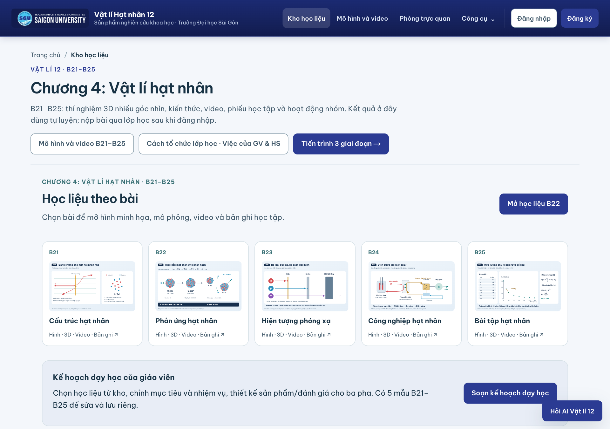

*Hình 1. Kho mở với menu học liệu và các lối vào theo bài B21–B25.*

Giáo viên có thể chuyển học liệu đang xem sang bàn soạn kế hoạch. Học sinh có thể mở kho để tự luyện. Hoạt động công khai và thao tác lưu trên trình duyệt được phân biệt với nhiệm vụ được giao trong lớp có tài khoản; việc xem kho không tự chứng minh học sinh đã hoàn thành nhiệm vụ học tập.

Bishop và Verleger (2013) mô tả lớp học đảo ngược qua hoạt động chuẩn bị có hướng dẫn ngoài lớp và giải quyết vấn đề tích cực theo nhóm trong lớp. Bản mẫu cụ thể hóa bốn lựa chọn tổ chức để giáo viên điều chỉnh: học trước rồi luyện tập; minh họa rồi thực hành; thảo luận theo vai; làm việc nhóm tạo sản phẩm (Hình 2). Đây là bốn kịch bản thiết kế giúp giáo viên phối hợp nhiệm vụ và phân bổ thời lượng giữa ở nhà với trên lớp, không phải phân loại cứng hoặc bốn mô hình đã được kiểm chứng thực nghiệm trong nghiên cứu này.

*Hình 2. Bốn lựa chọn tổ chức có hướng dẫn và mẫu kế hoạch để điều chỉnh.*

Học trước rồi luyện tập được minh họa bằng B23: dự đoán số hạt ở nhà, xử lí bảng và giải thích trên lớp. Minh họa rồi thực hành được minh họa bằng B25: xem hướng dẫn, thao tác và trình bày kết quả. B24 sử dụng thảo luận theo vai hoặc sản phẩm nhóm. Video, mô phỏng, infographic và phiếu là loại học liệu có thể kết hợp trong các hình thức này, không phải các hình thức lớp học riêng.

Trước giờ học, học sinh xem học liệu, dự đoán và ghi câu hỏi. Trong giờ học, giáo viên sử dụng các dự đoán để tổ chức quan sát, xử lí số liệu và thảo luận. Sau giờ học, học sinh sửa giải thích và tự luyện. Sản phẩm ở từng pha tạo căn cứ theo dõi việc chuẩn bị; hiệu quả của tiến trình cần được đánh giá trên lớp.

### 3.2. Học liệu tương tác và công cụ hỗ trợ tự học

#### 3.2.1. Infographic tương tác

Năm infographic của B21–B25 có các điểm chọn để mở phần quan sát, giải thích và câu hỏi. Ở B22, hình thể hiện neutron tới, U-236 kích thích và hai mảnh phân hạch; hai dòng phép cộng giúp học sinh kiểm tra số khối và điện tích (Hình 3). Nội dung phương trình được đối chiếu ví dụ trong SGK, trang in 100–101 (Vũ et al., 2024).

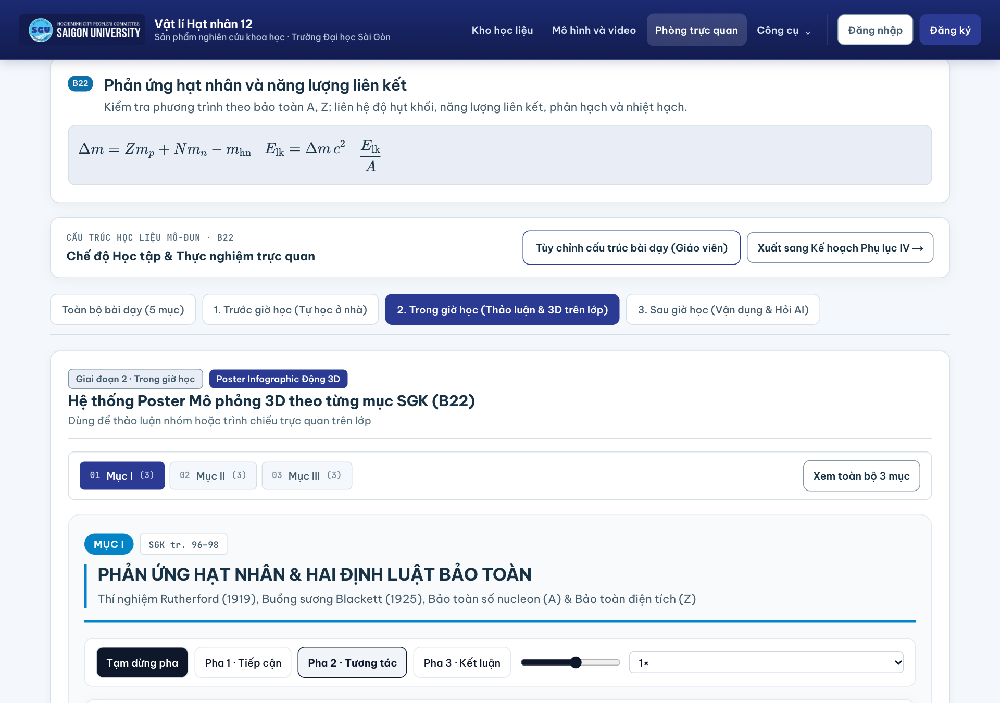

*Hình 3. Infographic B22 thể hiện một kênh phân hạch và các điểm tương tác.*

Hình có bản PNG để chèn vào bài giảng hoặc phiếu, bản SVG để chỉnh sửa bằng phần mềm hỗ trợ và chế độ xem lớn. Nhãn nút nêu công dụng của từng định dạng. Màu và kích thước được quy ước; hình không được dùng làm phép đo cấu trúc hay khoảng cách thực của hạt nhân.

Các điểm chọn giúp giao từng yêu cầu quan sát trước khi mở giải thích. Với B22, sản phẩm cần thu là phương trình và phép kiểm tra. Hình tĩnh hoặc tương tác đều phải giữ thống nhất kí hiệu và ý nghĩa khoa học.

#### 3.2.2. Mô phỏng phân hạch trong không gian 3D

Học sinh nhấn bắt đầu rồi quan sát bốn bước: neutron tới, hấp thụ, biến dạng và tách mảnh. Có thể tạm dừng, đặt lại, xem lại thời điểm và đổi góc nhìn. Một kênh được chọn để minh họa, không đại diện cho mọi sản phẩm phân hạch (Vũ et al., 2024; Urone & Hinrichs, 2022, mục 32.6).

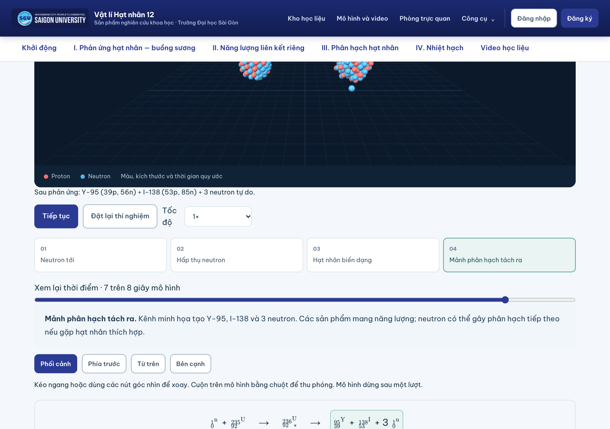

*Hình 4. Cảnh sau phân hạch với hai mảnh Y-95, I-138 và ba neutron tự do.*

Mô hình sử dụng 236 nucleon. Trước phản ứng, 235 + 1 = 236 và điện tích là 92; sau phản ứng, 95 + 138 + 3 = 236 và 39 + 53 = 92. Học sinh đếm neutron và giải thích khả năng neutron thoát ra hoặc bị hấp thụ. Với hệ số nhân k > 1, mô hình thể hiện sự tăng qua các thế hệ; không dùng điều kiện này để tự kết luận xảy ra vụ nổ.

Học sinh dự đoán số neutron, tạm dừng ở bước cuối và so sánh kết quả. Việc đổi góc nhìn hỗ trợ nhận diện, còn kết luận phải dựa trên phương trình và bảo toàn. Chuyển động, kích thước trong cảnh chỉ có ý nghĩa minh họa.

#### 3.2.3. Video hoạt hình 3D thuyết minh tiếng Việt và video nguồn kèm nhiệm vụ quan sát

Mỗi bài từ B21 đến B25 được xây dựng một video hoạt hình 3D thuyết minh tiếng Việt độ phân giải Full HD (1920×1080, 30 khung hình/giây, mã hóa H.264/AAC 48 kHz) kết hợp giọng đọc tổng hợp tiếng Việt tự nhiên (VieNeu-TTS v3 Turbo) và phụ đề chuẩn WebVTT (.vi.vtt), đặt cạnh các video nguồn quốc tế trên YouTube. Trước khi nhấn phát video, học sinh phải đọc nhiệm vụ quan sát và ghi dự đoán ban đầu. Ở B22, trình phát tích hợp trực tiếp video bài giảng 3D phân hạch hạt nhân và liên kết đối chiếu video của FuseSchool – Global Education (n.d.) với yêu cầu nhận diện neutron tới, hạt nhân hợp phần U-236*, hai mảnh phân hạch và số neutron thứ cấp sinh ra (Hình 5).

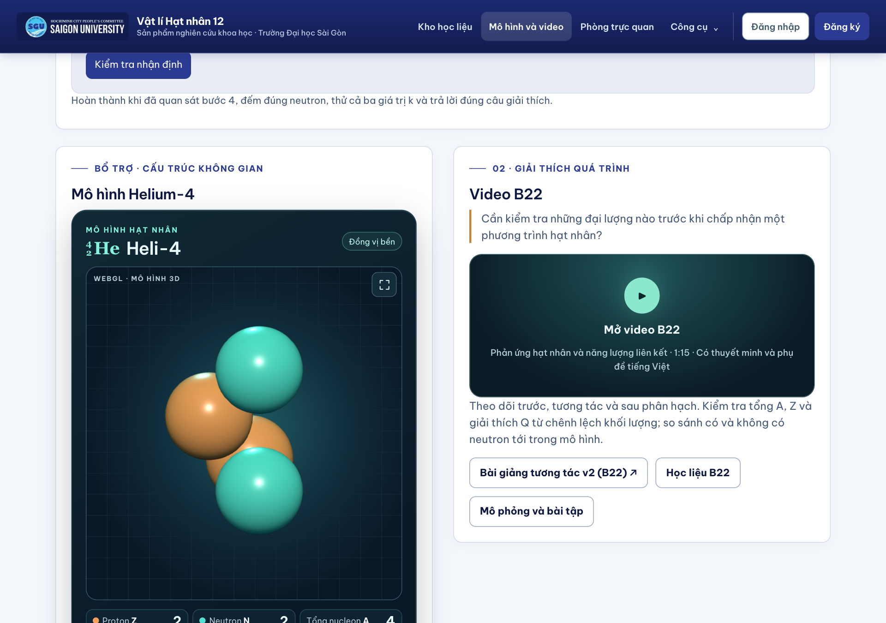

*Hình 5. Trình phát video bài giảng 3D thuyết minh tiếng Việt bài B22 kèm phụ đề và nhiệm vụ quan sát trước khi xem.*

Việc cung cấp song song video hoạt hình 3D thuyết minh tiếng Việt và video nguồn tiếng Anh giúp khắc phục rào cản ngôn ngữ khi học sinh tự học ở nhà, đồng thời giữ được nguồn tham khảo học thuật quốc tế để đối chiếu. Cả năm tệp video 3D nội bộ (b21.mp4–b25.mp4, tổng thời lượng 1.245,92 giây, dung lượng 76,5 MB) đều được lưu trữ trực tiếp trong kho học liệu của hệ thống kèm phụ đề tiếng Việt nên phát ổn định không phụ thuộc kết nối YouTube; đối với các video nhúng từ YouTube, giao diện luôn hiển thị tên kênh và liên kết mở nguồn trực tiếp khi mạng trường học hạn chế truy cập ngoài.

#### 3.2.4. Đồ thị bán rã và kiểm tra định lượng

Hoạt động B23 cho thay đổi chu kì bán rã T và số hạt ban đầu N₀, đồng thời cập nhật đồ thị và bảng. Mô hình dùng quy luật hàm mũ để biểu diễn số hạt còn lại theo thời gian; độ phóng xạ được liên hệ với số hạt qua hằng số phóng xạ (Urone & Hinrichs, 2022, mục 31.5). Số liệu trên Hình 6 là giá trị tính của mô hình, không phải số liệu đo thực nghiệm.

$$\Delta m = Z m({}^{1}\mathrm{H}) + N m_n - m_{\mathrm{nguy\hat{e}n\ t\ử}}, \qquad E_{\mathrm{lk}} = \Delta m \cdot c^2, \qquad E_{\mathrm{lkr}} = \frac{E_{\mathrm{lk}}}{A}$$

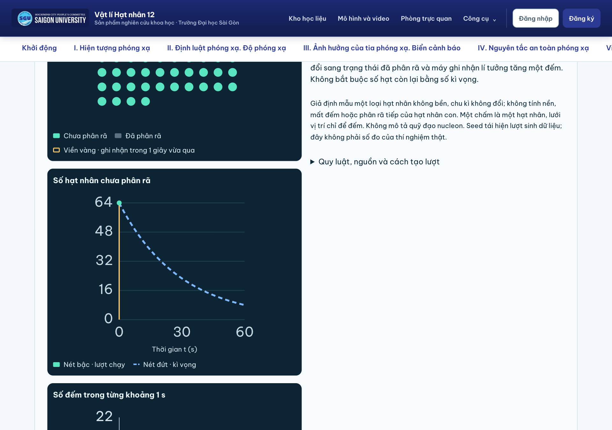

*Hình 6. Đồ thị và bảng khi N₀ = 1.000 và T = 30 s trong hoạt động B23.*

Với N₀ = 1.000, T = 30 s, giá trị tại t = 30 s là 500, sau 2T là 250 và sau 3T là 125. Khi tăng T lên 60 s, giá trị tại cùng t = 30 s khoảng 707,1; tăng N₀ gấp đôi sẽ tăng giá trị này gấp đôi. Đây là các trường hợp kiểm tra phép tính và phản hồi giao diện. Tham số của cảnh 3D được điều chỉnh riêng với bảng định lượng và được thông báo trên giao diện.

Nhiệm vụ so sánh yêu cầu giữ một tham số và đổi tham số còn lại. Dự đoán và bảng số liệu làm căn cứ giải thích. Giá trị khoảng 707,1 là kết quả của mô hình hàm mũ, không phải số hạt đếm được trong một lần quan sát mẫu nhỏ.

#### 3.2.5. Quy ước khối lượng và năng lượng liên kết

Hoạt động B25 dùng thống nhất khối lượng nguyên tử trung hòa. Công thức độ hụt khối sử dụng khối lượng nguyên tử ¹H thay cho khối lượng proton; bỏ qua năng lượng liên kết electron. Khối lượng được đối chiếu bảng A.1 và công thức ở mục 31.6 của Urone và Hinrichs (2022).

$$\Delta m = Z m({}^{1}\mathrm{H}) + N m_n - m_{\mathrm{nguy\hat{e}n\ t\ử}}, \qquad E_{\mathrm{lk}} = \Delta m \cdot c^2, \qquad E_{\mathrm{lkr}} = \frac{E_{\mathrm{lk}}}{A}$$

Trong biểu thức trên,  là khối lượng nguyên tử trung hòa của đồng vị đang xét;  là khối lượng nguyên tử ¹H và  là khối lượng neutron. Các khối lượng phải cùng đơn vị. Khi độ hụt khối tính bằng u, năng lượng được đổi theo 1 u tương ứng khoảng 931,5 MeV/c². Cần xác định loại khối lượng trước khi thay số.

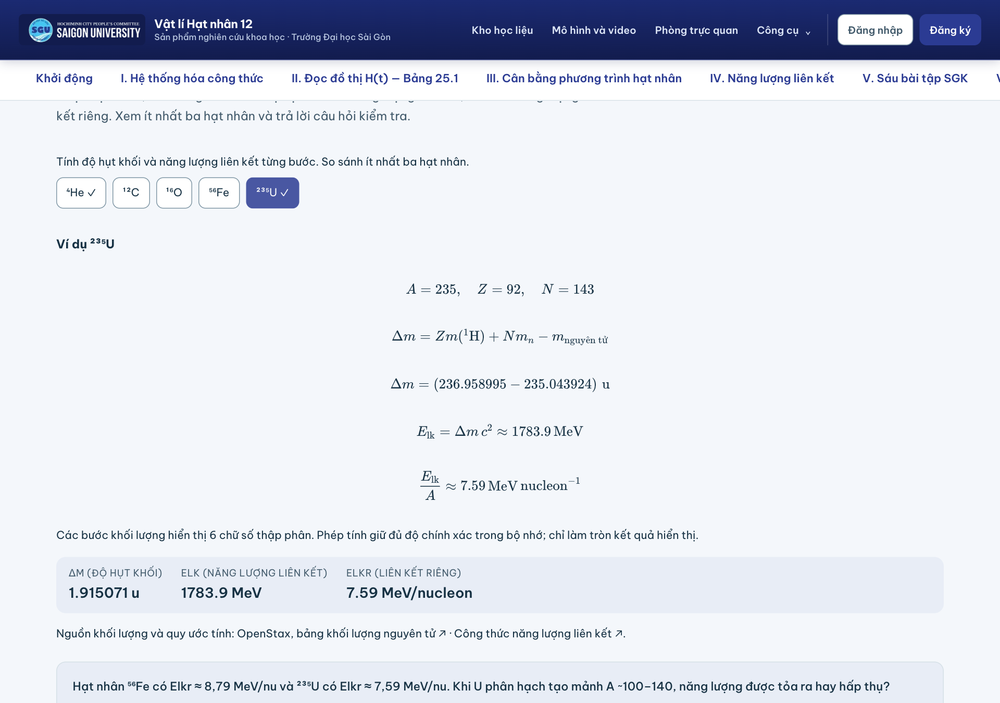

*Hình 7. Các bước tính độ hụt khối và năng lượng liên kết của U-235.*

Ví dụ U-235 có Z = 92, N = 143, khối lượng nguyên tử 235,043924 u. Với khối lượng nguyên tử ¹H là 1,007825 u và khối lượng neutron là 1,008665 u, tổng tính được là 236,958995 u, độ hụt khối 1,915071 u; dùng 931,5 MeV cho mỗi u cho năng lượng liên kết khoảng 1.783,9 MeV và năng lượng liên kết riêng khoảng 7,59 MeV/nucleon. Độ hụt khối làm tròn thành 1,91507 u, phù hợp giá trị cuối ở Hình 7. Tổng 236,95899 u hiển thị ở bước trung gian khác 0,000005 u so với phép tính lại; cần thống nhất quy tắc làm tròn. Kiểm tra đã dẫn đến sửa lỗi trộn hai quy ước khối lượng; đây không phải phép đo mới.

#### 3.2.6. Bàn soạn kế hoạch và nhiệm vụ của giáo viên học sinh

Bàn soạn có năm mẫu bài và kế hoạch trống. Giáo viên có thể sửa mục tiêu, thời lượng, học liệu, nhiệm vụ, sản phẩm, tiêu chí và hỗ trợ; mỗi hoạt động có trường riêng cho giáo viên và học sinh. Ở ví dụ thảo luận B24, giáo viên phân vai và yêu cầu bằng chứng, còn học sinh trình bày, phản biện và điều chỉnh kết luận (Hình 8).

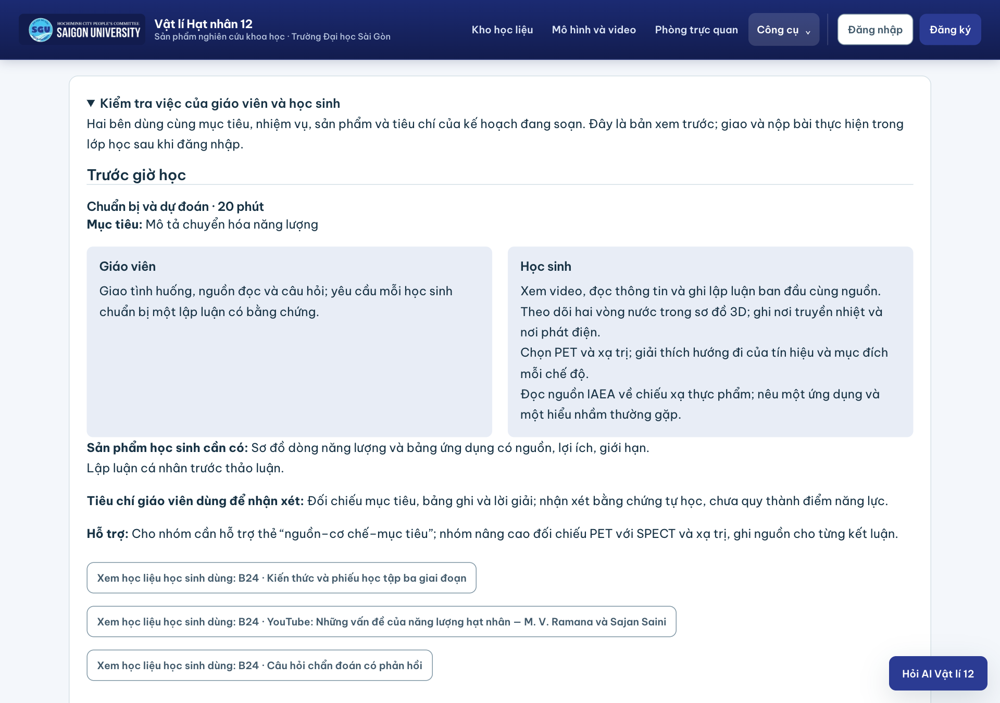

*Hình 8. Nhiệm vụ giáo viên và học sinh trong kế hoạch thảo luận B24.*

Trước giờ, giáo viên chọn nguồn và câu hỏi; học sinh chuẩn bị lập luận cá nhân. Trong giờ, hai vai cùng làm việc với sản phẩm nhưng có nhiệm vụ khác nhau. Sau giờ, giáo viên nhận xét, học sinh sửa giải thích và nêu điều cần học tiếp. Mẫu B24 còn dùng nguồn NIBIB để phân biệt PET với SPECT và nguồn IAEA cho ứng dụng thực phẩm (International Atomic Energy Agency, n.d.; National Institute of Biomedical Imaging and Bioengineering, n.d.). Kế hoạch lưu trên thiết bị có thể tiếp tục chỉnh sửa; lưu tài khoản và đưa vào lớp chưa được xác nhận vận hành.

#### 3.2.7. Bản ghi quan sát và phản tư tự học

Bản ghi gồm dự đoán, điều quan sát, giải thích và câu hỏi mang đến lớp (Hình 9). Thiết kế hướng tới việc lưu dấu quá trình chuẩn bị và kiểm tra cách hiểu. Cơ sở lí thuyết là tự điều chỉnh học tập và sự cần thiết của hướng dẫn trong lớp đảo ngược (Zimmerman, 2002; Liu et al., 2024).

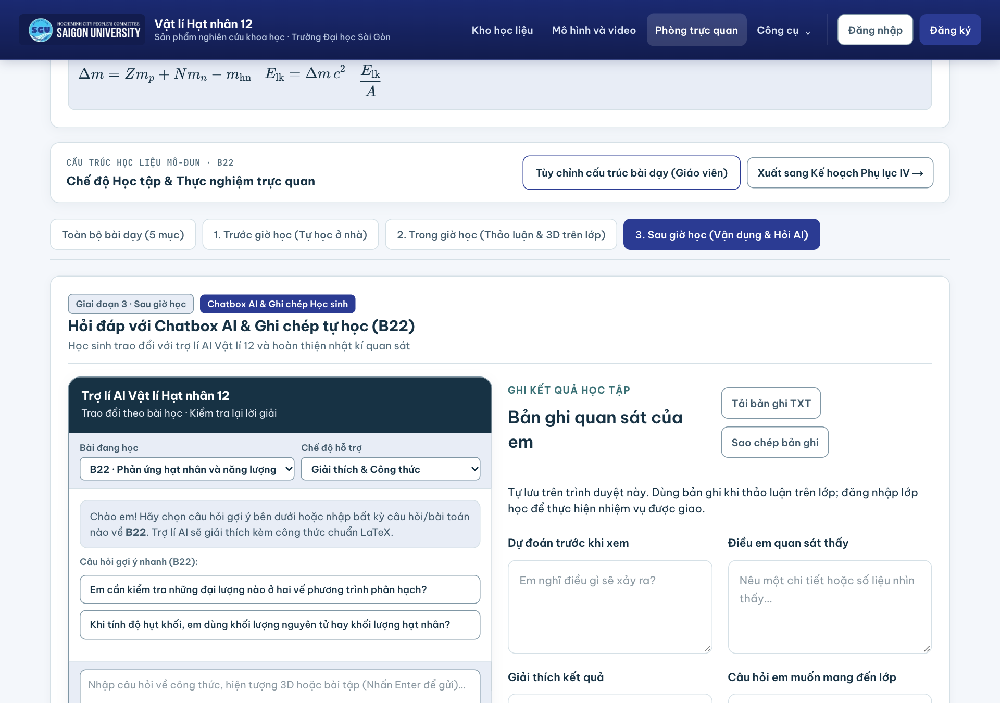

*Hình 9. Bốn trường của bản ghi quan sát; giao diện trống, chưa có dữ liệu học sinh.*

Ví dụ nhiệm vụ B22 yêu cầu ghi số neutron dự đoán, số quan sát ở bước cuối và cách kiểm tra phương trình. Giáo viên có thể nhận xét sự khác nhau giữa dự đoán và giải thích, thay vì căn cứ riêng số lần nhấn nút. Khung đề xuất theo dõi bốn biểu hiện: đặt mục tiêu hoặc kế hoạch; theo dõi; giải thích có nguồn; tự điều chỉnh. Đây là khung thiết kế chưa kiểm định, không được dùng để tuyên bố mức tăng năng lực tự học. Bản ghi ở kho mở tự lưu trên trình duyệt, chưa tự gửi cho giáo viên.

Bản ghi lưu mối liên hệ giữa dự đoán, quan sát và giải thích. Giáo viên có thể yêu cầu nêu một chỗ đã thay đổi cách hiểu cùng lí do. Số trường được điền không tự phản ánh chất lượng lập luận; tiêu chí chấm và độ tin cậy cần được nghiên cứu tiếp.

#### 3.2.8. Đề tự luyện theo phạm vi chủ đề

Kho có hai mã đề giữa kì trong phạm vi B21–B23 và hai mã đề cuối kì trong phạm vi B21–B25. Mỗi đề gồm 18 câu, thang 10 điểm; phần khách quan tối đa tám điểm, tự luận hai điểm cần giáo viên chấm. Thời gian mẫu là 45 phút và 60 phút. Hình 10 minh họa một lượt mở đề cuối kì, chưa chọn đáp án.

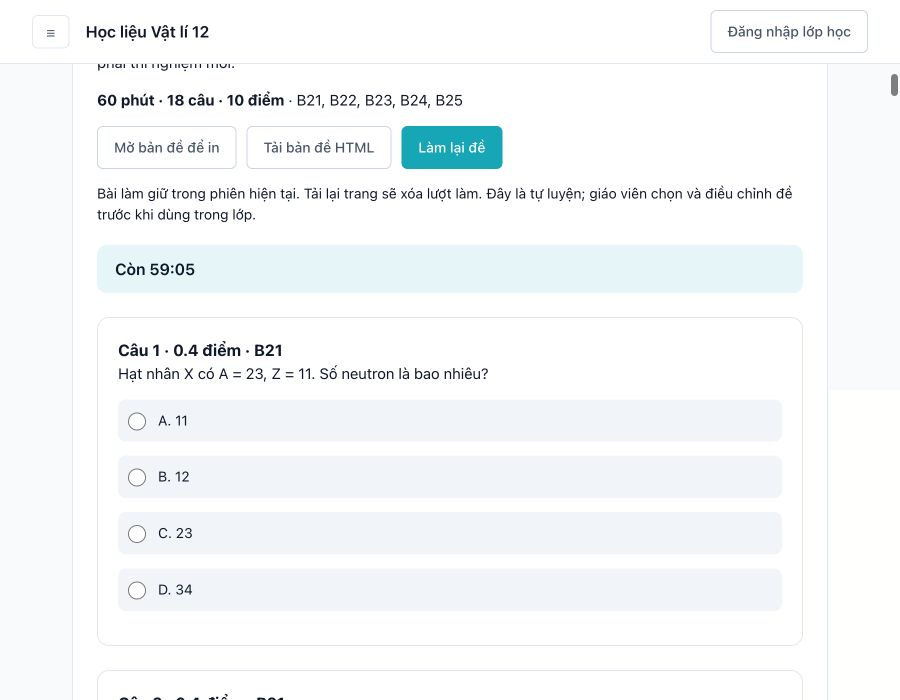

*Hình 10. Giao diện đề cuối kì mã A với phạm vi, thời gian và câu hỏi B21.*

Câu minh họa yêu cầu tìm số neutron khi A = 23 và Z = 11; đáp số là 12. Các ca kiểm tra chấm điểm xét câu bỏ trống, đúng–sai từng ý, dấu phẩy thập phân và dung sai đáp số. Ma trận và hướng dẫn chấm được cung cấp để giáo viên rà soát. Đề công khai là tài liệu tự luyện theo chủ đề, chưa là công cụ thực nghiệm có độ tin cậy và độ giá trị đã xác lập; không đại diện cho toàn bộ học kỳ Vật lí 12.

#### 3.2.9. Khung AI hỗ trợ học sinh trong trang học tập

Trang trợ lí AI học tập và nút hỏi bài nhanh cho phép học sinh chọn đúng bài đang học (B21–B25), đặt câu hỏi giải thích khái niệm hoặc nhận gợi ý từng bước (Hình 11). Mô hình Qwen3 4B Instruct chạy cục bộ qua Ollama trên máy chủ của hệ thống (Ollama, n.d.). Ở chế độ gợi ý Socratic, hệ thống xác định mã đoạn lí thuyết chuẩn từ SGK rồi đặt câu hỏi dẫn dắt để học sinh tự suy luận thay vì đưa ngay lời giải cuối cùng. Ở chế độ giải thích, hệ thống tạo bản nháp dựa trên đoạn kiến thức công khai của bài học, không truy cập điểm số hay đáp án đề kiểm tra của lớp. Các liên kết ngoài như Gemini, ChatGPT hoặc NotebookLM chỉ mở dịch vụ bên thứ ba bằng tài khoản riêng của người dùng, không phải mô hình chạy ngầm trong khung chat nội bộ.

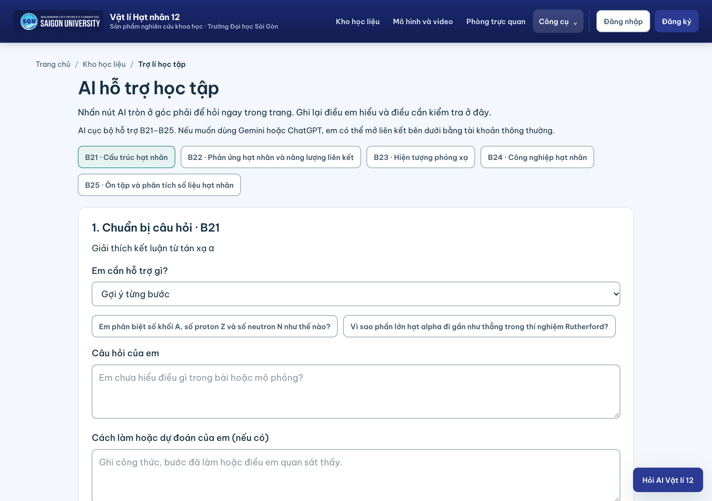

*Hình 11. Giao diện Trợ lí AI Vật lí 12 hỗ trợ học sinh tra cứu công thức, chọn câu hỏi gợi ý theo bài B21–B25 và kiểm tra lại lời giải.*

Trong các lượt kiểm tra nội bộ, câu hỏi về hai chu kì bán rã ở chế độ gợi ý trả về đúng hệ thức N(t) = N₀·2⁻ᵗ/ᵀ kèm câu hỏi dẫn dắt học sinh tính tỉ số N(t)/N₀. Kết quả này xác nhận luồng kết nối và khả năng neo vào đoạn nguồn của một lượt hỏi đáp, nhưng chưa xác lập độ chính xác tuyệt đối cho mọi câu hỏi tự do. Dịch vụ AI cục bộ hiện giới hạn xử lí tuần tự từng yêu cầu trên máy thử nghiệm 8 GB RAM; khi không có kết nối tới dịch vụ Ollama cục bộ, hệ thống tự động chuyển sang chế độ phản hồi dựa trên kho gợi ý biên soạn sẵn để không làm gián đoạn việc tự học.

#### 3.2.10. Ngân hàng câu hỏi từ ba sách và tạo đề theo ma trận

Roy et al. (2024) khảo sát việc sử dụng ChatGPT trong khâu chuẩn bị bài của giáo viên khoa học phổ thông ở Anh; bối cảnh đó gợi mở tiềm năng giảm tải biên soạn nhưng không tự động xác nhận hiệu quả của website nghiên cứu. Miao và Cukurova (2024) nhấn mạnh năng lực của giáo viên trong việc lựa chọn, kiểm chứng và điều chỉnh công cụ AI theo mục tiêu sư phạm. Từ định hướng đó, không gian hỗ trợ giáo viên trên hệ thống tích hợp ba phân hệ: ngân hàng đề theo ma trận, phiếu học tập ba pha và bàn chuẩn bị giờ học. Ngân hàng đề thống nhất gồm năm thẻ chức năng: trắc nghiệm nhiều lựa chọn, trắc nghiệm đúng–sai, trả lời ngắn, tự luận và tải ma trận/xuất tệp Word (Hình 12).

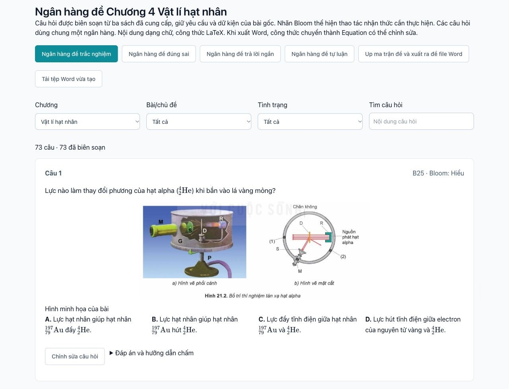

*Hình 12. Ngân hàng đề Chương 4 hiển thị câu hỏi dạng chữ kết hợp công thức LaTeX, nhãn bài học – mức độ Bloom và hình gốc trích từ SGK.*

Phạm vi biên tập ban đầu thu thập 232 mục bài tập và câu hỏi hoạt động của Chương 4 từ ba bộ sách được cung cấp. Qua rà soát đối chiếu văn bản, công thức và hướng dẫn giải, 208 mục gốc đạt yêu cầu rõ ràng về dữ kiện; 24 mục thiếu hình quét gốc hoặc có yêu cầu phụ thuộc ngữ cảnh trang sách được tách riêng khỏi tập chọn đề tự động. Sau khi chuẩn hóa và ghép các ý đúng–sai cùng bài/chủ đề thành câu hoàn chỉnh, ngân hàng chính thức công bố 213 câu hỏi: 73 câu trắc nghiệm bốn lựa chọn, 12 câu đúng–sai bốn ý, 19 câu trả lời ngắn và 109 câu tự luận. Sáu ý đúng–sai lẻ còn dư được lưu trữ riêng để giáo viên biên tập thủ công, tuyệt đối không dùng AI tự bịa thêm dữ kiện để ghép đủ câu.

Mỗi câu đúng–sai tuân thủ đúng cấu trúc bốn mệnh đề a, b, c, d theo định dạng kiểm tra đánh giá mới, lưu trữ khóa đáp án Đúng/Sai và giải thích riêng cho từng mệnh đề (Hình 13). Nhãn nhận thức Bloom được gắn theo thao tác tư duy học sinh cần thực hiện, tham chiếu khung phân loại sửa đổi của Krathwohl (2002), đồng thời ánh xạ sang ba mức Biết – Hiểu – Vận dụng trong ma trận đặc tả. Hình minh họa đi kèm câu hỏi được cắt nguyên bản từ sách giáo khoa để bảo toàn kí hiệu gốc; hiện có 25 hình gốc gắn với 33 câu hỏi đã công bố.

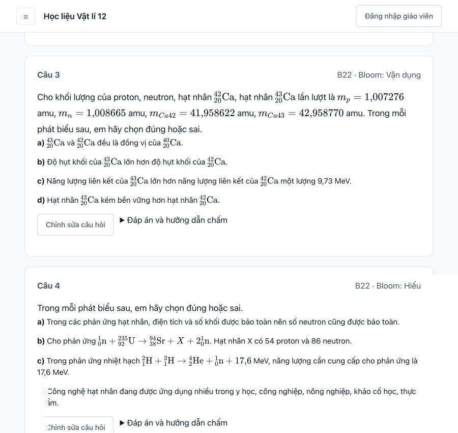

*Hình 13. Cấu trúc câu hỏi đúng–sai gồm bốn mệnh đề a–d kèm công thức chuẩn và nguồn truy xuất trong dữ liệu biên tập.*

Để tạo đề kiểm tra, giáo viên có thể nhập tệp CSV, JSON hoặc tải lên bảng ma trận DOCX/XLSX gồm năm cột bắt buộc: bài/chủ đề, loại câu, mức độ nhận thức, số câu và điểm mỗi câu. Các trường thông tin về chương, đơn vị kiến thức, yêu cầu cần đạt và biểu hiện năng lực vật lí được kết nối tự động vào bản đặc tả. Giao diện nhóm từng bài học (B21–B25) thành bốn ô loại câu trực quan, cho phép giáo viên lấy đồng thời câu trắc nghiệm, đúng–sai, trả lời ngắn và tự luận trong cùng một bài học ở nhiều mức độ khác nhau (Hình 14). Thuật toán chọn câu đảm bảo không trùng lặp mã câu hỏi và cảnh báo ngay khi một dòng ma trận thiếu nguồn câu trong ngân hàng.

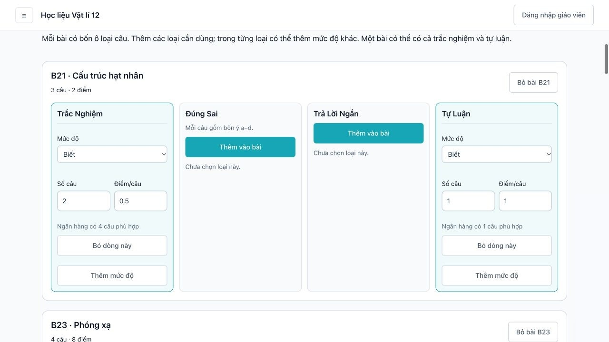

*Hình 14. Giao diện ma trận cho phép phối hợp bốn loại câu hỏi và nhiều mức độ nhận thức trong cùng bài B21.*

Tỉ lệ phân bố điểm theo định dạng câu hỏi và mức độ nhận thức được hệ thống cộng tổng trực tiếp từ cấu hình ma trận hiện hành. Cấu trúc tham khảo 30% – 20% – 20% – 30% theo loại câu và 40% – 30% – 30% theo mức độ nhận thức trong phụ lục Công văn 7991 được tích hợp làm mẫu đối chiếu để giáo viên cân đối theo kế hoạch kiểm tra của tổ chuyên môn (Bộ Giáo dục và Đào tạo, 2024). Khi giáo viên thêm hoặc bớt câu hỏi, hệ thống yêu cầu xác nhận lại điểm số và kiểm tra lại đề trước khi mở khóa chức năng xuất tệp Word.

#### 3.2.11. Phiếu học tập có hướng dẫn, nhiệm vụ và rubrics

Phân hệ thiết kế phiếu học tập ba pha vận hành theo quy trình ba bước: (1) chọn bài học và mẫu phiếu khởi tạo, (2) chỉnh sửa câu hỏi và hướng dẫn theo từng pha, (3) xem trước bố cục và xuất tệp Word (Hình 15). Mỗi mẫu phiếu mặc định trích xuất ba câu hỏi gốc cùng bài học để phân bổ vào giai đoạn trước giờ học, trong giờ học và sau giờ học. Giáo viên có thể hoán đổi vị trí pha, thay câu hỏi khác từ ngân hàng (tối đa chín câu trong một phiếu) và hiệu chỉnh yêu cầu sản phẩm. Trước khi xuất tệp, hệ thống kiểm tra tự động sự hiện diện của cả ba pha, yêu cầu cần đạt, thời lượng gợi ý, mục tiêu và tiêu chí đánh giá.

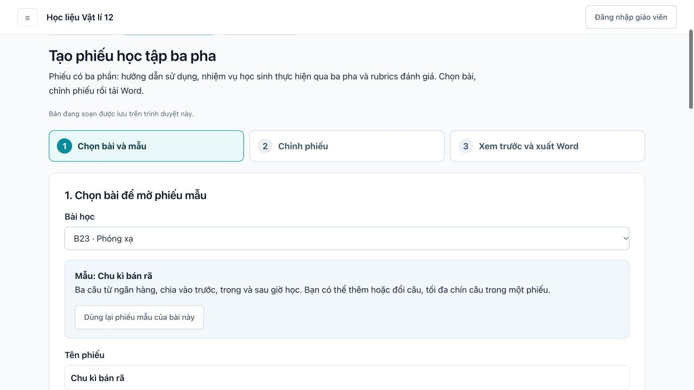

*Hình 15. Khởi tạo phiếu học tập ba pha với mẫu bài B23; quy trình biên soạn ba bước và mục tiêu được hiển thị rõ ràng.*

Tệp phiếu học tập xuất ra cho học sinh gồm ba phần liên kết chặt chẽ. Phần 1 trình bày hướng dẫn sử dụng phiếu, mục tiêu bài học, thời lượng dự kiến cho từng pha (ví dụ: trước giờ 15 phút, trong giờ 40 phút, sau giờ 15 phút), sản phẩm cần nộp và đường dẫn QR/URL tới học liệu số tương ứng (Hình 16). Phần 2 liệt kê các nhiệm vụ theo trình tự thời gian, giữ nguyên văn bản câu hỏi, công thức và khung trống để học sinh trình bày lời giải, ghi lại điểm chưa hiểu trước giờ học hoặc phần lập luận đã chỉnh sửa sau thảo luận trên lớp. Phần 3 cung cấp bảng rubrics để học sinh tự đánh giá và giáo viên ghi nhận xét phản hồi.

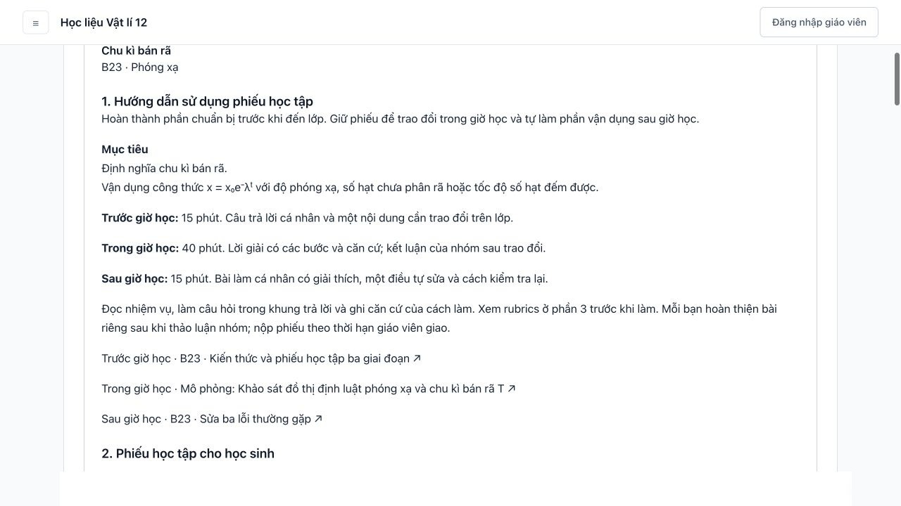

*Hình 16. Phần hướng dẫn sử dụng phiếu học tập B23 nêu rõ thời lượng, sản phẩm cần hoàn thành và học liệu số đi kèm ở từng pha.*

Ở phiếu mẫu bài B21, nhiệm vụ yêu cầu học sinh nhận diện nguồn phát hạt alpha, lá vàng mỏng và màn huỳnh quang ZnS từ Hình 21.2 của SGK, sau đó giải thích vì sao phần lớn hạt alpha đi thẳng nhưng một tỉ lệ rất nhỏ bị bật ngược trở lại (Hình 17). Khi xuất ra định dạng DOCX, hệ thống nhúng trực tiếp hình ảnh gốc độ phân giải cao và chuyển đổi toàn bộ biểu thức LaTeX sang đối tượng phương trình toán học gốc của Microsoft Word (OMML Equation). Hệ thống đồng thời tạo riêng bản phiếu dành cho học sinh (ẩn đáp án, có dòng kẻ làm bài) và bản hướng dẫn chấm dành cho giáo viên (có lời giải chi tiết và lưu ý sai lầm thường gặp).

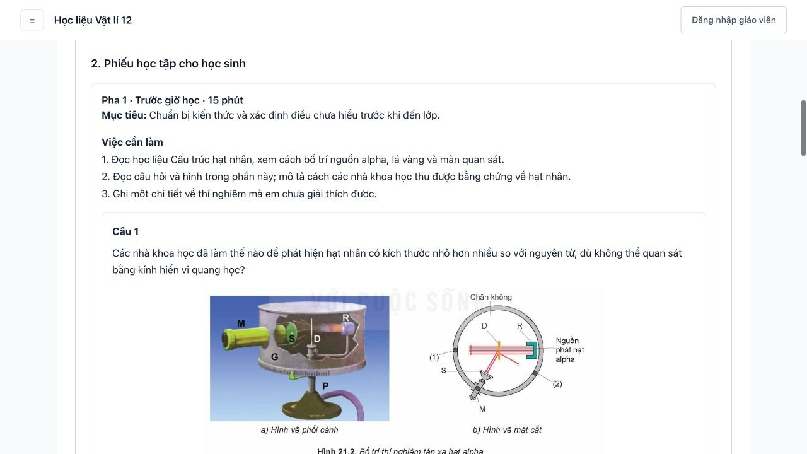

*Hình 17. Nhiệm vụ bài B21 kết hợp văn bản câu hỏi chuẩn và hình bố trí thí nghiệm tán xạ alpha trích từ SGK.*

Bảng rubrics đi kèm phiếu học tập được thiết kế theo cấu trúc phân tích (analytic rubric) gồm bốn tiêu chí: (1) mức độ hoàn thành chuẩn bị trước giờ học; (2) khả năng giải thích hiện tượng và sử dụng dữ kiện/bảo toàn trong giờ học; (3) mức độ vận dụng giải quyết bài tập sau giờ học; (4) hành vi tự kiểm tra, phát hiện lỗi và điều chỉnh nhận thức. Mỗi tiêu chí được tường minh hóa qua bốn mức độ mô tả hành vi và chất lượng sản phẩm cụ thể (Hình 18). Học sinh tự đánh dấu mức đạt được trước khi nộp; giáo viên đối chiếu với bài làm thực tế để ghi nhận xét định tính, giúp định hướng cách sửa lỗi thay vì chỉ cho điểm tổng kết.

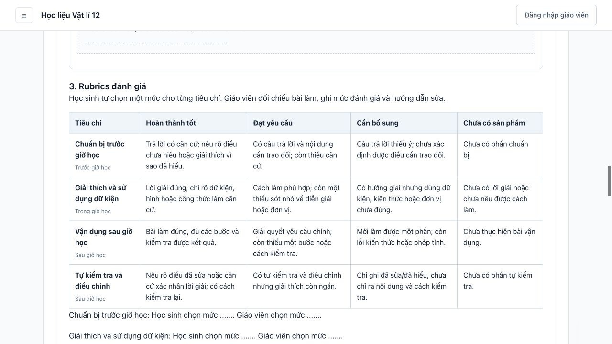

*Hình 18. Bảng rubrics bốn tiêu chí – bốn mức độ tích hợp khung đối chiếu giữa tự đánh giá của học sinh và nhận xét của giáo viên.*

#### 3.2.12. Kế hoạch bài dạy gắn với nhiệm vụ trong phiếu

Phân hệ chuẩn bị giờ học giúp giáo viên chuyển hóa trực tiếp các nhiệm vụ trong phiếu học tập và học liệu 3D thành kế hoạch bài dạy theo cấu trúc Công văn 5512 qua ba bước: thiết lập điều kiện lớp học, biên soạn chuỗi hoạt động và rà soát cấu trúc trước khi xuất Word. Ở bước đầu, giáo viên xác định khối lớp, thời lượng tiết học trên lớp (45 phút hoặc 90 phút), điều kiện thiết bị phòng học và thời lượng tự học ở nhà (Hình 19). Tiếp theo, giáo viên chọn các yêu cầu cần đạt được trích xuất chính xác từ Chương trình Giáo dục phổ thông môn Vật lí 2018 (trang 27–28) phù hợp với trọng tâm tiết dạy (Hình 20).

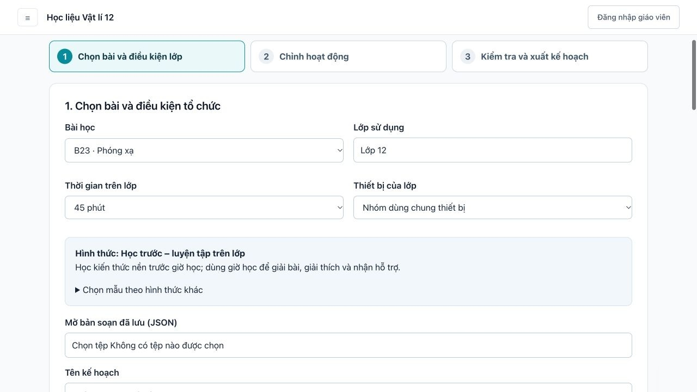

*Hình 19. Thiết lập bài học, điều kiện thiết bị lớp học và phân bổ thời lượng trên lớp – ở nhà trước khi biên soạn hoạt động.*

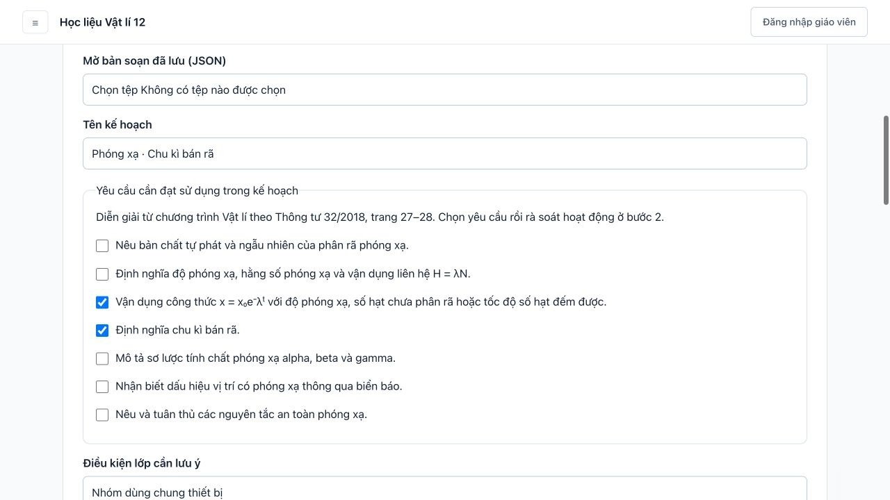

*Hình 20. Lựa chọn các yêu cầu cần đạt của chủ đề Phóng xạ bám sát Chương trình môn Vật lí 2018.*

Trong kế hoạch mẫu bài B23, ba nhiệm vụ của phiếu học tập được gắn kết liền mạch vào tiến trình sư phạm. Trước giờ học, học sinh xem video 3D, nêu định nghĩa chu kì bán rã T và ghi lại thắc mắc. Trên lớp (45 phút) gồm: hoạt động mở đầu (5 phút) tổng hợp nhanh các dự đoán từ phiếu chuẩn bị; hoạt động hình thành kiến thức và luyện tập (30 phút) tổ chức cho học sinh thao tác trên mô phỏng phân rã để giải quyết bài toán định lượng (ví dụ: mẫu đồng vị O-15 sau 244 giây đã phân rã 75% số hạt ban đầu, suy ra số hạt còn lại chiếm 25% = 1/2² nên 244 s = 2T và T = 122 s); hoạt động kết luận và hoàn thiện lời giải cá nhân (10 phút). Sau giờ học, học sinh giải bài tập vận dụng và hoàn thành bảng tự đánh giá (15 phút). Mỗi thẻ hoạt động đều tách biệt rõ cột hành động của giáo viên, hành động của học sinh, sản phẩm dự kiến và tiêu chí đánh giá (Hình 21).

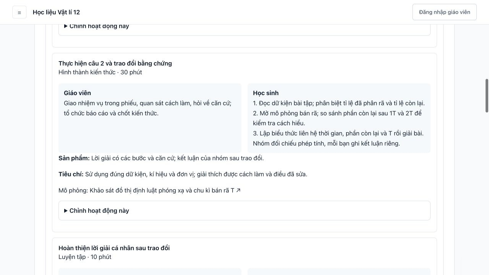

*Hình 21. Thiết kế hoạt động trong giờ học phân tách rõ nhiệm vụ tổ chức của giáo viên và thao tác kiểm chứng mô phỏng của học sinh.*

Khi xuất kế hoạch bài dạy ra tệp Word, tài liệu tuân thủ đầy đủ bốn mục lớn theo Phụ lục IV Công văn 5512: I. Mục tiêu (năng lực vật lí, năng lực tự chủ và tự học, phẩm chất), II. Thiết bị dạy học và học liệu, III. Tiến trình dạy học và IV. Điều chỉnh sau bài dạy (Hình 22). Trong mục Tiến trình dạy học, các hoạt động được sắp xếp theo ba thời điểm của lớp học đảo ngược nhưng vẫn giữ nguyên bốn loại hoạt động chuẩn (mở đầu, hình thành kiến thức, luyện tập, vận dụng) cùng bốn bước tổ chức thực hiện (chuyển giao nhiệm vụ, thực hiện nhiệm vụ, báo cáo – thảo luận, kết luận – nhận định). Giáo viên có thể lưu bản nháp trên trình duyệt, xuất tệp JSON để chia sẻ trong tổ bộ môn hoặc tải trực tiếp tệp DOCX.

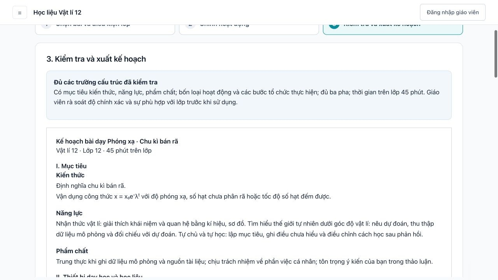

*Hình 22. Màn hình kiểm tra cấu trúc kế hoạch bài dạy theo Công văn 5512 trước khi xuất tệp Word.*

Bộ kiểm tra quy tắc nội bộ tự động phát hiện các trường thông tin còn bỏ trống, pha học tập bị khuyết hoặc tổng thời gian các hoạt động trên lớp lệch khỏi khung 45/90 phút đã chọn. Khi giáo viên chọn chèn thêm một hoạt động khắc phục khó khăn nhận thức của học sinh, hệ thống tự động thay thế vào khung thời gian của hoạt động hình thành kiến thức tương ứng để tránh cộng dồn làm cháy giáo án. Tuy nhiên, việc vượt qua bộ quy tắc cấu trúc chỉ đảm bảo tính đầy đủ về hình thức, giáo viên vẫn giữ vai trò quyết định về tính phù hợp sư phạm đối với từng đối tượng học sinh.

#### 3.2.13. Xuất tài liệu và kiểm tra AI trong môi trường thử

Sau khi hoàn tất ma trận và chọn câu hỏi, giáo viên rà soát toàn bộ nội dung đề, công thức và hướng dẫn chấm, tích chọn ô xác nhận đã kiểm duyệt rồi mới kích hoạt lệnh xuất đề, đáp án hoặc bản đặc tả ra tệp Word. Hệ thống hỗ trợ trộn từ một đến bốn mã đề từ cùng một tập câu hỏi đã chọn, bảo toàn mối liên kết giữa phần dẫn, hình minh họa, điểm số và khóa đáp án khi hoán vị phương án. Liên kết tải tệp DOCX được duy trì trong 15 phút kèm nút tải lại trực tiếp trên giao diện (Hình 23). Các ca kiểm thử tự động xác nhận toàn bộ kí hiệu đồng vị hạt nhân có đủ chỉ số trên/dưới (như ²³⁵₉₂U) và các công thức phân rã đều chuyển đổi sang đối tượng OMML Equation không phát sinh kí tự lỗi ô vuông.

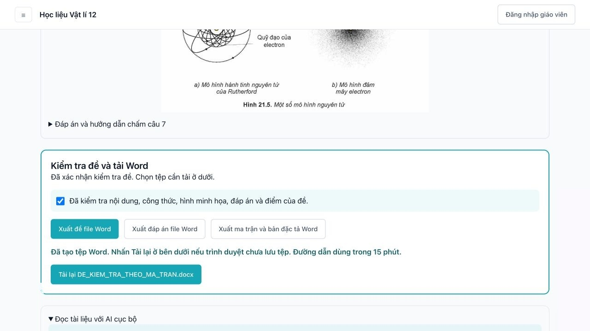

*Hình 23. Khung xác nhận kiểm duyệt đề và liên kết tải trực tiếp tệp Word (đề kiểm tra, đáp án, ma trận đặc tả).*

Trong phân hệ hỗ trợ giáo viên, trợ lí AI cục bộ được thử nghiệm với nhiệm vụ tóm tắt học liệu bài B23 và gợi ý câu hỏi chẩn đoán: mô hình trích xuất đúng hệ thức độ phóng xạ H = λN và quy luật giảm một nửa sau mỗi chu kì bán rã T, đồng thời hiển thị nguyên văn các đoạn nguồn SGK bên dưới để giáo viên đối chiếu trực tiếp (Hình 24). Quá trình kiểm tra nội bộ từng phát hiện một lượt sinh văn bản của mô hình 4B viết chưa chuẩn diễn đạt “Z giảm −2” trong phân rã alpha (cần diễn đạt chuẩn là “số hiệu nguyên tử Z giảm 2 đơn vị”). Để khắc phục triệt để nguy cơ AI tự biến đổi số liệu bài tập, chức năng gợi ý nhiệm vụ hỗ trợ được thiết kế theo cơ chế lai: AI chỉ phân tích mô tả khó khăn của giáo viên để chọn mã câu hỏi phù hợp nhất từ ngân hàng câu hỏi đã biên tập, sau đó hệ thống trích xuất nguyên văn câu hỏi và đáp án chuẩn từ cơ sở dữ liệu.

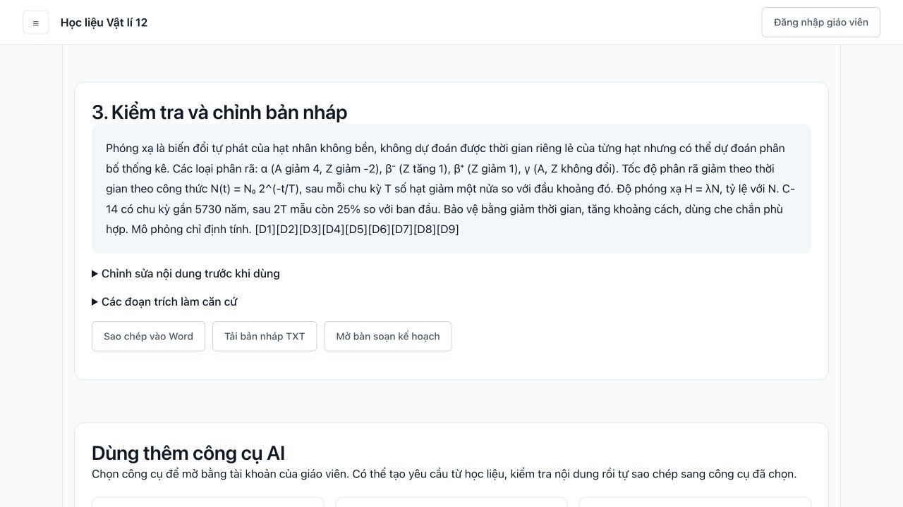

*Hình 24. Bản nháp tóm tắt học liệu do AI cục bộ tạo kèm các đoạn nguồn SGK đối chiếu trực tiếp dành cho giáo viên.*

#### 3.2.14. Chuỗi năm bài học tương tác cấu trúc theo SGK Vật lí 12 và video hoạt hình 3D thuyết minh tiếng Việt

Để khắc phục tình trạng học sinh phải chuyển qua lại rời rạc giữa văn bản lí thuyết, mô phỏng 3D và video bài giảng khi tự học ở nhà, phiên bản nâng cấp của hệ thống xây dựng chuỗi năm trang bài học tương tác chuyên sâu (B21–B25 tại đường dẫn /hoc-lieu/phong-hat-nhan-v2) có thanh chuyển bài liên thông và mục lục bám sát từng tiểu mục của sách giáo khoa Vật lí 12 Kết nối tri thức với cuộc sống (Vũ et al., 2024). Mỗi tiểu mục kết hợp trực tiếp văn bản cô đọng, công thức LaTeX, thí nghiệm mô phỏng tương tác có câu hỏi dự đoán và video hoạt hình 3D thuyết minh tiếng Việt.

Ở Bài 21 (Cấu trúc hạt nhân), học sinh bắt đầu bằng thí nghiệm tán xạ hạt alpha của Rutherford với khả năng chạy song song hai điều kiện bắn (Điều kiện A và Điều kiện B) để so sánh trực tiếp ảnh hưởng của tham số va chạm b (từ 5 fm đến 120 fm) và động năng hạt alpha E (MeV) lên góc lệch quỹ đạo θ trên đồng hồ thời gian mẫu zeptogiây (1 zs = 10⁻²¹ s) (Hình 25). Các tiểu mục tiếp theo cho phép học sinh tự lắp ghép hạt nhân từ Z proton và N neutron để phân biệt nucleon, số khối A = Z + N, chuỗi đồng vị Hydro (¹₁H, ²₁H, ³₁H) – Carbon (¹²₆C, ¹³₆C, ¹⁴₆C) và kiểm chứng hệ thức bán kính hạt nhân R = R₀·A¹/³ với R₀ = 1,2×10⁻¹⁵ m.

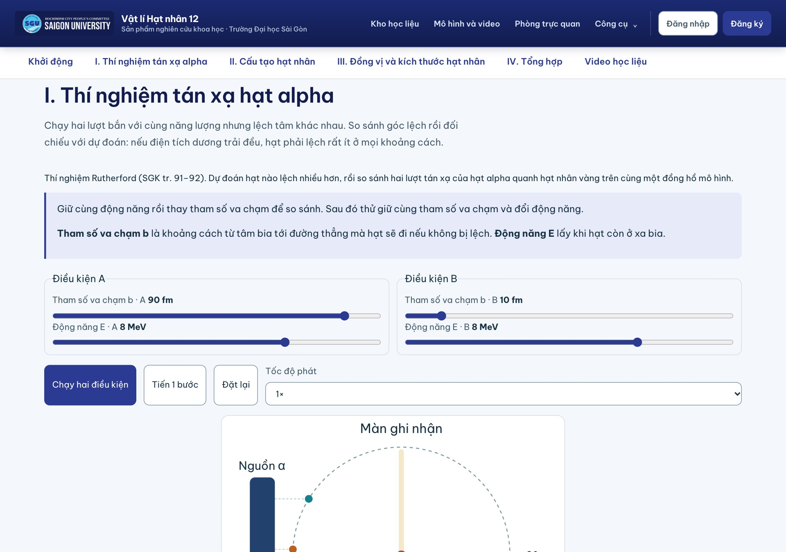

*Hình 25. Bài 21 tương tác: Mô phỏng tán xạ hạt alpha của Rutherford cho phép đối chứng đồng thời hai điều kiện tham số va chạm b và động năng E.*

Ở Bài 22 (Phản ứng hạt nhân và năng lượng liên kết), nội dung đi từ thí nghiệm buồng sương Blackett (1925) ghi nhận phản ứng biến đổi hạt nhân nhân tạo đầu tiên (⁴₂He + ¹⁴₇N → ¹⁷₈O + ¹₁H), công cụ kiểm tra định luật bảo toàn số nucleon A và điện tích Z, đến phòng thí nghiệm khảo sát lực hạt nhân, độ hụt khối Δm, năng lượng liên kết E_lk = Δm·c² và đồ thị năng lượng liên kết riêng E_lk/A theo số khối A với đỉnh bền vững cực đại quanh vùng ⁵⁶₂₆Fe ≈ 8,8 MeV/nucleon (Hình 26). Hai tiểu mục cuối tích hợp mô phỏng 3D phân hạch dây chuyền ²³⁵₉₂U và tổng hợp nhiệt hạch D–T.

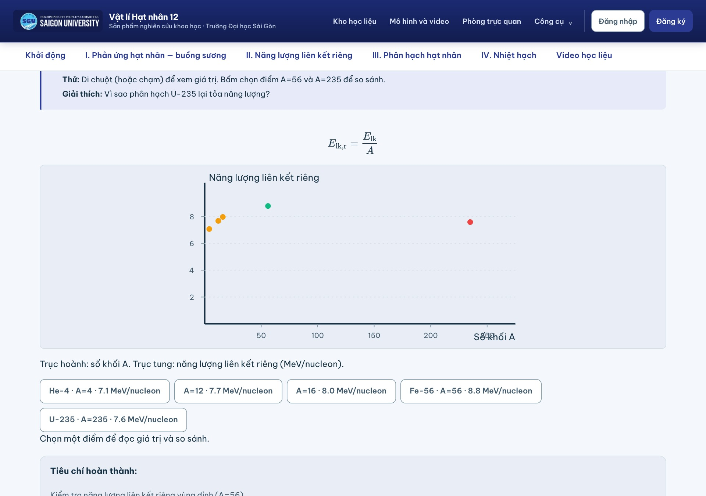

*Hình 26. Bài 22 tương tác: Khảo sát lực hạt nhân, độ hụt khối Δm và đường cong năng lượng liên kết riêng E_lk/A theo số khối A.*

Ở Bài 23 (Hiện tượng phóng xạ), trang học tập kết nối bốn nội dung: (1) mô phỏng buồng sương quan sát vết tia phóng xạ và sự lệch của ba loại tia α, β (β⁻, β⁺), γ trong từ trường đều hay qua các lớp vật liệu che chắn (giấy, nhôm, chì); (2) mô phỏng ống đếm Geiger–Müller kiểm chứng tính tự phát và ngẫu nhiên của quá trình phân rã trong các khoảng thời gian 5 giây, đặt cạnh bảng số liệu thực nghiệm Bảng 23.1 của SGK trang 105 (Hình 27); (3) phòng thí nghiệm định luật phóng xạ khảo sát đồng thời đường cong N(t) = N₀·2⁻ᵗ/ᵀ và độ phóng xạ H(t) = λN(t); (4) biển cảnh báo bức xạ và quy tắc an toàn ALARA (Thời gian – Khoảng cách – Che chắn).

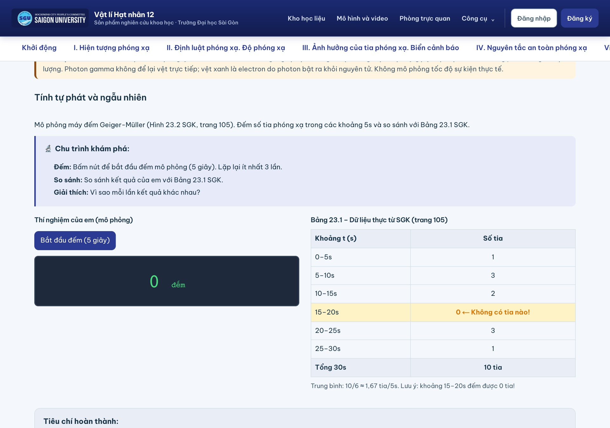

*Hình 27. Bài 23 tương tác: Mô phỏng ống đếm Geiger–Müller kiểm chứng tính ngẫu nhiên của phóng xạ đối chiếu trực tiếp với Bảng 23.1 SGK.*

Ở Bài 24 (Công nghiệp hạt nhân), học sinh thao tác điều chỉnh độ cắm sâu của thanh điều khiển chứa Boron/Cadmium để khảo sát sự thay đổi của hệ số nhân neutron k (k < 1 tắt dần, k = 1 tới hạn ổn định, k > 1 vượt tới hạn) qua từng thế hệ phân hạch, đồng thời theo dõi sơ đồ hai vòng tuần hoàn tải nhiệt tách biệt trong nhà máy điện hạt nhân lò nước áp lực (PWR) theo Hình 24.1 và 24.3 của SGK (Hình 28). Các tiểu mục ứng dụng tiếp theo trình bày nguyên lí chẩn đoán hình ảnh chức năng bằng dược chất phóng xạ (SPECT, PET/CT), xạ trị ung thư và công nghệ chiếu xạ bảo quản nông sản, kiểm định khuyết tật mối hàn công nghiệp.

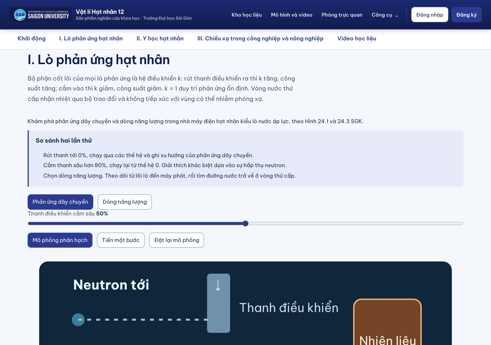

*Hình 28. Bài 24 tương tác: Mô phỏng điều khiển hệ số nhân neutron k bằng thanh hấp thụ và sơ đồ dòng năng lượng trong lò phản ứng PWR.*

Ở Bài 25 (Bài tập về vật lí hạt nhân), trang học tập hệ thống hóa toàn bộ công thức trọng tâm của Chương 4 và triển khai hoạt động thực hành phân tích dữ liệu phóng xạ theo đúng Bảng 25.1 của SGK trang 121 (tám mốc đo độ phóng xạ H(t) từ t = 0 s với H₀ = 151 Bq đến t = 360 s với H = 16 Bq). Học sinh điều chỉnh chu kì bán rã giả thuyết T (ví dụ đối chứng giữa T = 40 s và T = 60 s), bật đường cong lí thuyết H(t) = 151·2⁻ᵗ/ᵀ Bq và bấm vào từng mốc thời gian để đọc độ lệch giữa số liệu thực nghiệm do tính ngẫu nhiên thống kê với giá trị hàm mũ lí thuyết (Hình 29).

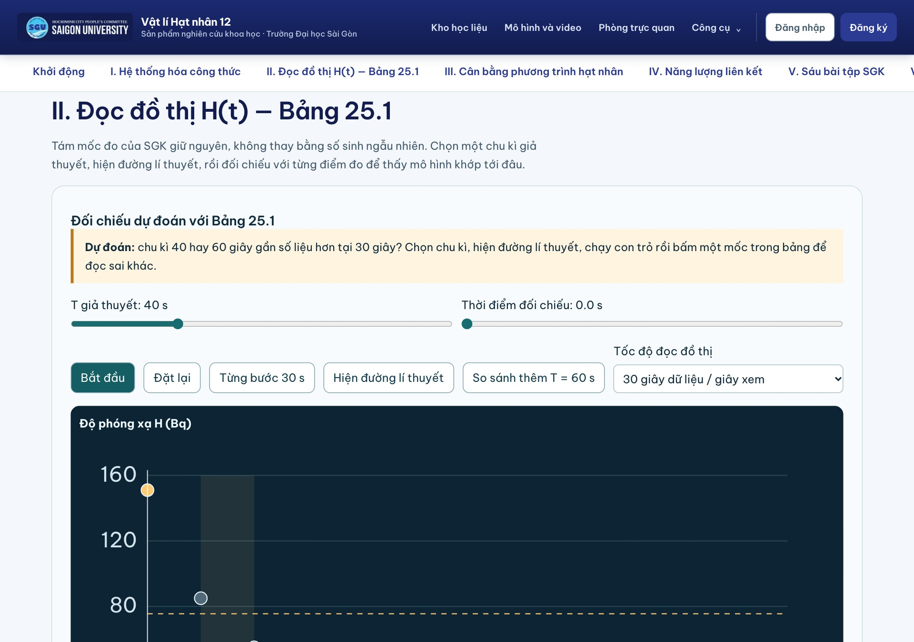

*Hình 29. Bài 25 tương tác: Phân tích đồ thị thực nghiệm H(t) từ tám mốc đo Bảng 25.1 SGK và ước lượng chu kì bán rã T.*

Song hành với năm trang bài học tương tác, nhóm nghiên cứu đã thiết kế và kết xuất bộ năm video hoạt hình 3D thuyết minh tiếng Việt (b21.mp4 đến b25.mp4) gồm tổng cộng 26 cảnh hoạt hình 3D chuyển động liên tục (1920×1080, 30 fps) đồng bộ với lời giảng tiếng Việt và phụ đề WebVTT (Hình 30). Các cảnh 3D tái hiện trực quan những quá trình vi mô then chốt: quỹ đạo tán xạ Coulomb 3D của chùm hạt alpha quanh hạt nhân vàng và cấu trúc nguyên tử Carbon-12 3D với ba quỹ đạo electron nghiêng (B21); biến dạng giọt chất lỏng của hạt nhân kích thích ²³⁶₉₂U* trước khi tách thành hai mảnh ⁹⁵₃₉Y, ¹³⁸₅₃I kèm ba neutron thứ cấp (B22); mạng tinh thể lập phương 4×4×4 gồm 64 hạt nhân phóng xạ chuyển trạng thái ngẫu nhiên qua từng chu kì bán rã T (B23); vùng hoạt lò phản ứng hạt nhân 3D với các bó nhiên liệu, thanh điều khiển nâng hạ theo thời gian thực và dòng hạt truyền nhiệt (B24); ống đếm Geiger–Müller 3D ghi nhận xung phóng xạ kết hợp đồ thị xác định chu kì bán rã từ Bảng 25.1 SGK (B25).

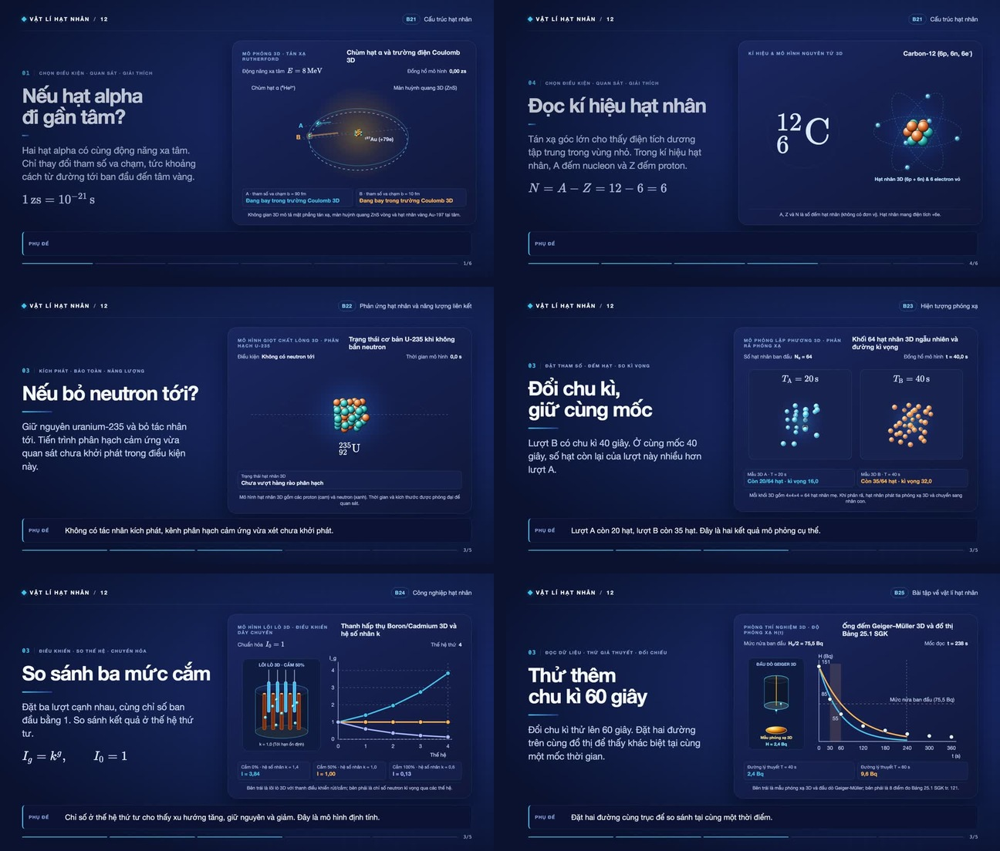

*Hình 30. Sáu cảnh trích xuất từ bộ năm video hoạt hình 3D thuyết minh tiếng Việt (B21–B25): tán xạ Rutherford 3D, nguyên tử C-12 3D, phân hạch giọt chất lỏng U-235 3D, mạng phân rã 64 hạt nhân 3D, tâm lò phản ứng PWR 3D và thực hành đo bán rã Bảng 25.1.*

#### 3.2.15. Cơ chế kiểm chứng việc chuẩn bị trước giờ học và quy trình sáu tiêu chí rà soát tri thức vật lí của AI

Một thách thức phổ biến của mô hình lớp học đảo ngược là học sinh chỉ mở lướt qua video hoặc bấm thử mô phỏng một cách cơ học mà không thực sự suy nghĩ trước khi đến lớp (van Alten et al., 2019; Liu et al., 2024). Để giải quyết vấn đề này về mặt thiết kế sư phạm, hệ thống thiết lập cơ chế kiểm chứng việc chuẩn bị trước giờ học qua chu trình ba bước bắt buộc gắn với bằng chứng cụ thể: (1) Cam kết dự đoán trước khi quan sát: trước khi xem video 3D hoặc chạy mô phỏng, học sinh phải điền câu trả lời dự đoán vào trường “Dự đoán trước khi xem” (ví dụ: dự đoán góc lệch hạt alpha khi giảm tham số va chạm b ở B21, hoặc dự đoán số hạt còn lại sau hai chu kì bán rã ở B23); (2) Thu thập dữ kiện định lượng trong khi thao tác: nhiệm vụ yêu cầu học sinh trích xuất các con số cụ thể từ trạng thái dừng của mô phỏng hoặc mốc thời gian của video (như ghi nhận A = 95 + 138 + 3 = 236 ở bước 04 của mô phỏng phân hạch B22, hoặc đọc độ lệch ΔH tại t = 60 s trong Bảng 25.1 ở B25) vào trường “Điều em quan sát thấy”; (3) Câu hỏi chẩn đoán cổng vào và phản tư: học sinh trả lời câu hỏi kiểm tra nhanh có phản hồi tức thì, đối chiếu sự khác biệt giữa dự đoán ban đầu với kết quả mô phỏng và ghi lại ít nhất một câu hỏi thắc mắc mang đến lớp. Giáo viên dựa trên sự chênh lệch giữa dự đoán và giải thích cùng danh sách câu hỏi thắc mắc để tổ chức thảo luận đầu tiết học, thay vì đánh giá dựa trên thao tác bấm nút đơn thuần.

Bên cạnh đó, nhằm đảm bảo độ chính xác khoa học khi tích hợp mô hình ngôn ngữ lớn cục bộ (Qwen3 4B Instruct) vào chủ đề Vật lí hạt nhân, mọi câu trả lời nháp của AI và học liệu biên soạn trên hệ thống đều được kiểm soát qua quy trình sáu tiêu chí rà soát tri thức vật lí (K1–K6): (K1) Bảo toàn số nucleon và điện tích: mọi phương trình phản ứng hạt nhân và phân rã phóng xạ phải thỏa mãn đồng thời ∑A_trước = ∑A_sau và ∑Z_trước = ∑Z_sau (kiểm tra rõ hạt β⁻ có A = 0, Z = −1 và β⁺ có A = 0, Z = +1); (K2) Nhất quán quy ước khối lượng: phân biệt tường minh khối lượng hạt nhân trần m_hn với khối lượng nguyên tử trung hòa m_nguyên tử khi tính độ hụt khối Δm, tuyệt đối không trộn hai quy ước trong cùng một phép tính và thống nhất hệ số quy đổi 1 u·c² ≈ 931,5 MeV theo chuẩn SGK; (K3) Chuẩn xác kí hiệu, đơn vị SI và đại lượng: phân biệt rõ số hạt chưa phân rã N(t) với độ phóng xạ H(t) = λN(t) (đơn vị Becquerel, 1 Bq = 1 phân rã/s), dùng đúng chỉ số trên cho số khối A và chỉ số dưới cho số hiệu nguyên tử Z; (K4) Minh bạch giới hạn của mô hình trực quan: nêu rõ màu sắc, kích thước hạt và thang thời gian trong mô phỏng/video 3D là quy ước sư phạm, đồng thời không suy diễn điều kiện vượt tới hạn k > 1 trong lò phản ứng năng lượng thành vụ nổ hạt nhân; (K5) Truy xuất đúng đoạn nguồn SGK: phản hồi của AI phải kèm mã đoạn nguồn công khai để giáo viên và học sinh kiểm chứng, không tự ý bịa thêm số liệu thực nghiệm ngoài SGK; (K6) Định hướng sư phạm gợi mở: đối với học sinh, AI đặt câu hỏi dẫn dắt theo từng bước tư duy thay vì giải hộ trọn vẹn bài tập về nhà.

### 3.3. Kết quả kiểm tra nội bộ và nội dung cần hoàn thiện

**Bảng 2. Bằng chứng kiểm tra nội bộ sản phẩm đến ngày 10/11/2026**

| Hạng mục | Bằng chứng cụ thể | Giới hạn |
| --- | --- | --- |
| Kiến thức và tính toán | Bảo toàn số khối A và điện tích Z; tán xạ Rutherford theo b và E; quy luật bán rã và Bảng 23.1, 25.1 SGK; thống nhất khối lượng nguyên tử trung hòa cho năm hạt nhân; quy trình sáu tiêu chí rà soát AI (K1–K6). | Đối chiếu các ví dụ và bảng số liệu SGK đã xét; chưa có biên bản thẩm định toàn bộ bởi hội đồng chuyên gia độc lập. |
| Phần mềm và kiểm thử tự động | 102/102 ca kiểm tra Vitest (8 bộ test) và 5/5 ca kiểm tra kịch bản video đạt; build đạt; kiểm thử Playwright trên Chrome không phát sinh lỗi console hay pageerror. | Chưa thay thế kiểm thử tải đồng thời cả lớp và nghiên cứu thực nghiệm tại trường THPT. |
| Giao diện và khả năng đáp ứng | Chụp 30 hình giao diện SGU và cảnh video 3D; kiểm tra trình duyệt ở chiều rộng 1440 px, 1280 px, 900 px và 390 px không tràn ngang. | Không suy rộng cho mọi thiết bị di động cũ hoặc phần mềm đọc màn hình chuyên biệt. |
| Video 3D thuyết minh và lưu cục bộ | Năm video hoạt hình 3D thuyết minh tiếng Việt (b21.mp4–b25.mp4, 1920×1080, 30 fps, phụ đề .vi.vtt, tổng thời lượng 1.245,92 s) đều phát đạt readyState = 4; năm video nguồn YouTube và lưu cục bộ đã kiểm tra. | Giọng đọc tổng hợp TTS cần giáo viên nghe duyệt theo tốc độ lớp; chưa thử tải tệp trên máy chủ triển khai khác. |
| Giao và nộp nhiệm vụ qua lớp | Đã bổ sung migration cơ sở dữ liệu và kiểm tra phân quyền RLS trên môi trường thử; phiên trước các bảng lộ trình, tiến độ, kế hoạch từng trả mã PGRST205 khi chưa áp dụng schema. | Cần kiểm thử đầy đủ luồng giao bài, nộp bài và chấm điểm hai vai bằng tài khoản thật của giáo viên và học sinh. |
| Đánh giá sư phạm và tự học | Có chuỗi năm bài tương tác B21–B25 bám sát SGK, nhiệm vụ ba pha, phiếu học tập kèm rubrics bốn tiêu chí và cơ chế kiểm chứng chuẩn bị trước giờ học. | Chưa có ý kiến chuyên gia độc lập, dữ liệu học sinh thực nghiệm hoặc kết quả định lượng về mức tăng năng lực tự học. |

Các lỗi phát hiện và đã khắc phục qua chu trình kiểm tra nội bộ gồm: (1) trộn lẫn khối lượng nguyên tử trung hòa với khối lượng hạt nhân trần trong phép tính độ hụt khối ở B25; (2) diễn đạt điều kiện hệ số nhân neutron k > 1 dễ gây hiểu nhầm là lò phản ứng phát nổ như vũ khí hạt nhân ở B24; (3) chưa phân biệt rõ cơ chế tạo ảnh của PET (cặp photon gamma 511 keV từ hủy positron–electron) với SPECT ở B24; (4) thiếu cơ chế chuyển đổi nhanh giữa năm bài học tương tác B21–B25 và đồng bộ đường dẫn video 3D giữa hai không gian phòng học hạt nhân; (5) tràn ngang phương án trả lời ở chiều rộng 390 px. Việc ghi nhận lỗi và căn cứ chỉnh sửa minh họa vai trò của bước kiểm tra nội bộ trong nghiên cứu thiết kế; tuy nhiên, 102/102 ca kiểm tra phần mềm đạt chỉ xác nhận các kịch bản kĩ thuật đã lập trình.

Kết quả kiểm tra phân biệt rõ những hạng mục đã hoàn tất về mặt kĩ thuật với những nội dung cần tiếp tục hoàn thiện trước khi triển khai thực nghiệm sư phạm. Thao tác lưu cục bộ trên trình duyệt phục vụ tự luyện công khai khác về bản chất với luồng giao bài, thu bài và theo dõi tiến độ qua tài khoản lớp học. Do đó, Bảng 2 đóng vai trò là hồ sơ rà soát trước sử dụng và là căn cứ để tổ chức xin ý kiến chuyên gia độc lập ở giai đoạn tiếp theo.

## 4. Kết luận và bình luận

Nghiên cứu đã cụ thể hóa quy trình phân tích, thiết kế, kiến tạo và kiểm tra nội bộ hệ thống học liệu số có hỗ trợ AI cho chủ đề Vật lí hạt nhân (B21–B25) theo mô hình lớp học đảo ngược. Sản phẩm hoàn thiện gồm danh mục 89 mục học liệu, 17 mô phỏng 3D tương tác, chuỗi năm bài học tương tác chuyên sâu cấu trúc bám sát mục lục SGK Vật lí 12, bộ năm video hoạt hình 3D thuyết minh tiếng Việt kèm phụ đề, năm infographic tương tác, bản ghi quan sát bốn trường và bộ công cụ biên soạn dành cho giáo viên. Ngân hàng câu hỏi công bố 213 câu đã đối chiếu từ ba bộ sách; công cụ ma trận cho phép phối hợp bốn định dạng câu hỏi và xuất tệp Word chỉnh sửa được; phiếu học tập tích hợp hướng dẫn ba pha và rubrics bốn tiêu chí; bàn soạn kế hoạch bài dạy phân tách rõ hoạt động của giáo viên và học sinh theo Công văn 5512.

Đóng góp về mặt thiết kế sư phạm của sản phẩm là thiết lập cơ chế gắn kết chặt chẽ giữa thao tác quan sát trực quan (mô phỏng 3D, video hoạt hình 3D, đồ thị thực nghiệm SGK) với nhiệm vụ dự đoán, bằng chứng định lượng và sản phẩm phản tư của học sinh ở cả ba giai đoạn trước, trong và sau giờ học. Chẳng hạn, hoạt động tán xạ Rutherford ở B21 yêu cầu đối chứng hai tham số va chạm b và động năng E; mô phỏng phân hạch ở B22 buộc học sinh kiểm chứng hai định luật bảo toàn số nucleon và điện tích; hoạt động phóng xạ ở B23 và B25 kết nối mô hình hàm mũ với số liệu thực nghiệm trong Bảng 23.1 và Bảng 25.1 của SGK. Những thiết kế này cụ thể hóa khung hỗ trợ tự điều chỉnh học tập của Zimmerman (2002) và Liu et al. (2024), nhưng tự thân giao diện phần mềm chưa đủ để kết luận học sinh đã tăng hứng thú, kết quả học tập hay năng lực tự học nếu chưa có dữ liệu thực nghiệm trên lớp.

Trí tuệ nhân tạo hỗ trợ cả ở khâu kiến tạo học liệu (biên tập mã nguồn, tổng hợp giọng đọc thuyết minh tiếng Việt cho video 3D) và trong giao diện sử dụng (khung hỏi đáp cục bộ dùng mô hình Qwen3 4B Instruct qua Ollama cho học sinh; công cụ tóm tắt học liệu và gợi ý nhiệm vụ khắc phục khó khăn cho giáo viên). Để kiểm soát rủi ro sai lệch khái niệm và ảo giác tri thức trong Vật lí hạt nhân, hệ thống áp dụng nguyên tắc chỉ trích xuất từ kho đoạn nguồn SGK đã biên tập kèm quy trình sáu tiêu chí rà soát tri thức vật lí (K1–K6) trước khi giáo viên sử dụng. Các chức năng AI hiện tại dừng ở mức tạo bản nháp hỗ trợ và gợi mở Socratic, chưa tự động theo dõi dài hạn hay cá nhân hóa lộ trình của từng học sinh.

Nghiên cứu có bốn giới hạn cần nêu rõ: (1) chưa tiến hành thực nghiệm sư phạm trên mẫu học sinh THPT và chưa có biên bản thẩm định độc lập từ hội đồng chuyên gia ngoài nhóm nghiên cứu; (2) 102 ca kiểm tra Vitest, 5 ca kiểm tra kịch bản video và các lượt chạy thử trên trình duyệt chỉ xác nhận tính đúng đắn kĩ thuật của các trường hợp đã xét; (3) trong 232 mục bài tập gốc trích xuất từ ba sách, có 24 mục thiếu hình quét hoặc dữ kiện và sáu ý đúng–sai lẻ được giữ ngoài tập chọn đề tự động; (4) nhãn mức độ nhận thức Bloom và rubrics bốn mức hiện là tiêu chí phân loại nội bộ, chưa được kiểm định độ tin cậy liên người chấm (inter-rater reliability) và độ giá trị đo lường.

Hướng phát triển tiếp theo của đề tài gồm ba bước: (1) tổ chức thẩm định độc lập nội dung vật lí, kịch bản video 3D, ngân hàng câu hỏi và rubrics bởi các giảng viên lí luận dạy học Vật lí và giáo viên THPT có kinh nghiệm; (2) kiểm thử toàn diện luồng giao bài, nộp sản phẩm và phản hồi hai chiều bằng tài khoản lớp học thực tế trên cơ sở dữ liệu đám mây; (3) triển khai thực nghiệm sư phạm tại trường THPT để thu thập dữ liệu định lượng và định tính về sự phát triển năng lực tự học của học sinh qua chủ đề Vật lí hạt nhân.

### Tuyên bố về vai trò của các tác giả

Theo phân công ở pha thiết kế, Võ Đoàn Đăng Khôi: xây dựng ý tưởng, thiết kế phương pháp nghiên cứu, tổ chức thiết kế học liệu và viết bản thảo ban đầu. Nguyễn Bảo Thy: phân tích chương trình, xây dựng ma trận mục tiêu–nội dung–hoạt động–đánh giá và kiểm chứng nội dung khoa học. Bùi Ngọc Xuân Phương: thiết kế học liệu trực quan, mô phỏng, câu hỏi tương tác; quản lí phiên bản và hồ sơ kiểm duyệt. Bài báo chưa báo cáo nhiệm vụ thực nghiệm hoặc phân tích dữ liệu học sinh.

### Tuyên bố về GenAI và quyền tác giả

Codex (OpenAI) và Claude/Gemini được sử dụng để hỗ trợ lập trình giao diện mô phỏng 3D, kiểm thử tự động và định dạng bản thảo; mô hình VieNeu-TTS v3 Turbo được sử dụng để tổng hợp giọng đọc thuyết minh tiếng Việt cho năm video bài giảng 3D. Trong bản mẫu web, Qwen3 4B Instruct chạy cục bộ qua Ollama để tạo bản nháp giải thích, gợi ý câu hỏi dẫn dắt và tóm tắt học liệu. Các tác giả chịu trách nhiệm hoàn toàn về việc kiểm tra, đối chiếu và chỉnh sửa toàn bộ nội dung khoa học, công thức vật lí, số liệu và trích dẫn trước khi gửi công bố.

Mô hình ngôn ngữ cục bộ trên web: qwen3:4b-instruct-2507-q4_K_M chạy qua Ollama 0.35.1; mô hình tổng hợp giọng đọc video học liệu: VieNeu-TTS v3 Turbo (giọng Kim Thanh, 48 kHz). Môi trường kiểm thử tự động: Node.js, Vitest (102 tests), Playwright (Google Chrome headless) và FFmpeg/ffprobe.

### Tuyên bố về xung đột lợi ích

Các tác giả tuyên bố không có xung đột lợi ích nào liên quan đến việc công bố bài báo này.

### Thông tin tài trợ

Nghiên cứu này thuộc phạm vi đề tài nghiên cứu khoa học sinh viên Khoa Sư phạm Khoa học Tự nhiên, Trường Đại học Sài Gòn.

### Lời cảm ơn

Nhóm tác giả trân trọng cảm ơn PGS.TS. Nguyễn Thị Nhị, Khoa Sư phạm Khoa học Tự nhiên, Trường Đại học Sài Gòn, cán bộ hướng dẫn đề tài nghiên cứu khoa học của nhóm.

## Tài liệu tham khảo

- Bishop, J. L., & Verleger, M. A. (2013). The flipped classroom: A survey of the research. In 2013 ASEE Annual Conference & Exposition (pp. 23.1200.1–23.1200.18). ASEE Conferences. https://doi.org/10.18260/1-2--22585
- Bộ Giáo dục và Đào tạo. (2018). Chương trình giáo dục phổ thông môn Vật lí (Ban hành kèm theo Thông tư số 32/2018/TT-BGDĐT). https://thcsandong.haiphong.edu.vn/van-ban-bo-gddt/chuong-trinh-giao-duc-pho-thong-mon-vat-ly-ban-hanh-kem-theo-thong-tu-so-322018/vbctmb/20343/91436
- Bộ Giáo dục và Đào tạo. (2020). Khung kế hoạch bài dạy (Phụ lục IV kèm Công văn số 5512/BGDĐT-GDTrH ngày 18/12/2020).
- Bộ Giáo dục và Đào tạo. (2024). Công văn số 7991/BGDĐT-GDTrH về thực hiện kiểm tra, đánh giá đối với cấp THCS, THPT.
- FuseSchool – Global Education. (n.d.). What is nuclear fission? | Radioactivity | Physics | FuseSchool [Video]. YouTube. https://www.youtube.com/watch?v=D91T-B-PVE0
- Huỳnh, T. Y. N., Nguyễn, T. T. H., & Lê, A. Đ. (2026). Tích hợp lịch sử vật lí nguyên tử và hạt nhân trong giảng dạy. Tạp chí Khoa học Trường Đại học Sư phạm Thành phố Hồ Chí Minh, 23(SI1), 537–547. https://doi.org/10.54607/hcmue.js.23.SI1.5418(2026)
- International Atomic Energy Agency. (n.d.). Food irradiation. https://www.iaea.org/topics/food-irradiation
- Krathwohl, D. R. (2002). A revision of Bloom’s taxonomy: An overview. Theory Into Practice, 41(4), 212–218. https://doi.org/10.1207/s15430421tip4104_2
- Liu, L., Hew, K. F., & Du, J. (2024). Design principles for supporting self-regulated learning in flipped classrooms: A systematic review. International Journal of Educational Research, 124, Article 102319. https://doi.org/10.1016/j.ijer.2024.102319
- Mai, H. P., Hồ, V. T., Phan, T. T., Phạm, T. P. U., & Nguyễn, T. M. D. (2024). Xây dựng và sử dụng học liệu số hỗ trợ dạy học mạch nội dung Động lượng – Vật lí 10 theo mô hình lớp học đảo ngược. TNU Journal of Science and Technology, 229(01/S), 197–206. https://doi.org/10.34238/tnu-jst.9209
- McKenney, S., & Reeves, T. C. (2019). Conducting educational design research (2nd ed.). Routledge. https://www.routledge.com/Conducting-Educational-Design-Research-2nd-Edition/McKenney-Reeves/p/book/9781138095564
- Miao, F., & Cukurova, M. (2024). AI competency framework for teachers. UNESCO. https://www.unesco.org/en/articles/ai-competency-framework-teachers
- Miao, F., & Holmes, W. (2023). Guidance for generative AI in education and research. UNESCO. https://doi.org/10.54675/EWZM9535
- National Institute of Biomedical Imaging and Bioengineering. (n.d.). Nuclear medicine. https://www.nibib.nih.gov/science-education/science-topics/nuclear-medicine
- Ollama. (n.d.). qwen3:4b-instruct-2507-q4_K_M. https://ollama.com/library/qwen3:4b-instruct-2507-q4_K_M
- Roy, P., Poet, H., Staunton, R., Aston, K., & Thomas, D. (2024). ChatGPT in lesson preparation: A Teacher Choices trial. Education Endowment Foundation. https://d2tic4wvo1iusb.cloudfront.net/production/documents/projects/chatgpt_in_lesson_planning_-_evaluation_report.pdf
- Urone, P. P., & Hinrichs, R. (2022). College physics (2nd ed.). OpenStax. https://openstax.org/details/books/college-physics-2e
- van Alten, D. C. D., Phielix, C., Janssen, J., & Kester, L. (2019). Effects of flipping the classroom on learning outcomes and satisfaction: A meta-analysis. Educational Research Review, 28, Article 100281. https://doi.org/10.1016/j.edurev.2019.05.003
- Vũ, V. H., Nguyễn, V. B., Trần, N. C., Phạm, K. C., Đặng, T. H., Tưởng, D. H., & Bùi, G. T. (2024). Vật lí 12 (Kết nối tri thức với cuộc sống; bản mẫu tháng 1/2024). Nhà xuất bản Giáo dục Việt Nam.
- Zimmerman, B. J. (2002). Becoming a self-regulated learner: An overview. Theory Into Practice, 41(2), 64–70. https://doi.org/10.1207/s15430421tip4102_2
